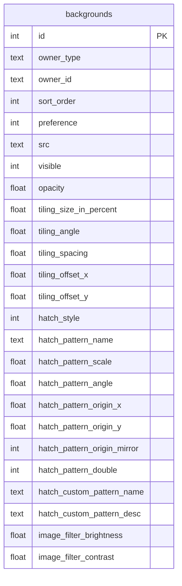
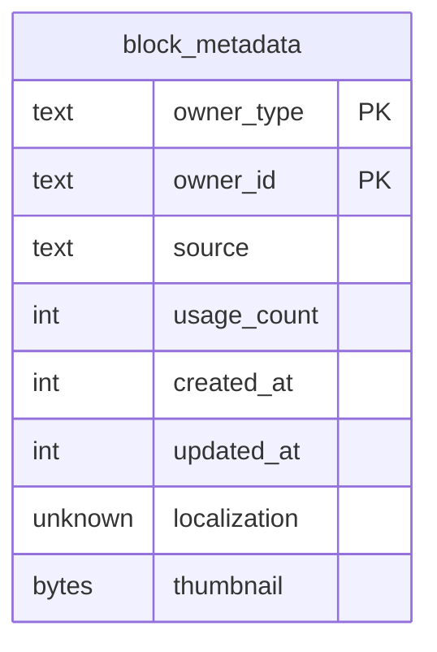
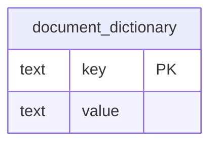
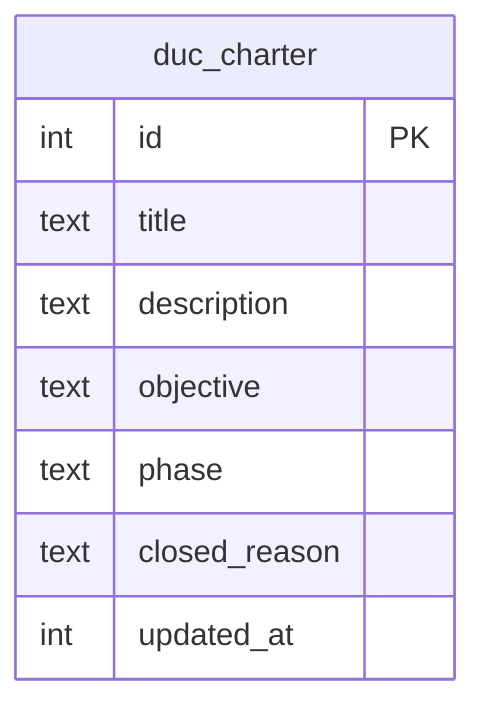
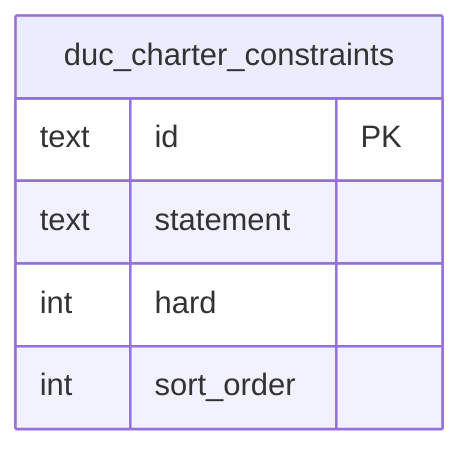

# DUC SQLite Schema Reference

Authoritative relational schema documentation for `.duc` (gzip-compressed SQLite) files.
Contains full table definitions, column types, default values, foreign keys, and ER diagrams.

---

## backgrounds

*table · 0 rows*



### Columns

| Column | Type | Nullable | PK | FK | Auto | Default |
| --- | --- | --- | --- | --- | --- | --- |
| id | INTEGER | ✓ | ✓ |  | auto_inc |  |
| owner_type | TEXT |  |  |  |  |  |
| owner_id | TEXT |  |  |  |  |  |
| sort_order | INTEGER |  |  |  |  | 0 |
| preference | INTEGER | ✓ |  |  |  |  |
| src | TEXT |  |  |  |  | &#39;&#39; |
| visible | INTEGER |  |  |  |  | 1 |
| opacity | REAL |  |  |  |  | 1.0 |
| tiling_size_in_percent | REAL | ✓ |  |  |  |  |
| tiling_angle | REAL | ✓ |  |  |  |  |
| tiling_spacing | REAL | ✓ |  |  |  |  |
| tiling_offset_x | REAL | ✓ |  |  |  |  |
| tiling_offset_y | REAL | ✓ |  |  |  |  |
| hatch_style | INTEGER | ✓ |  |  |  |  |
| hatch_pattern_name | TEXT | ✓ |  |  |  |  |
| hatch_pattern_scale | REAL | ✓ |  |  |  |  |
| hatch_pattern_angle | REAL | ✓ |  |  |  |  |
| hatch_pattern_origin_x | REAL | ✓ |  |  |  |  |
| hatch_pattern_origin_y | REAL | ✓ |  |  |  |  |
| hatch_pattern_origin_mirror | INTEGER | ✓ |  |  |  |  |
| hatch_pattern_double | INTEGER | ✓ |  |  |  |  |
| hatch_custom_pattern_name | TEXT | ✓ |  |  |  |  |
| hatch_custom_pattern_desc | TEXT | ✓ |  |  |  |  |
| image_filter_brightness | REAL | ✓ |  |  |  |  |
| image_filter_contrast | REAL | ✓ |  |  |  |  |

### Indexes

| Index | Columns | Unique | Primary | Type |
| --- | --- | --- | --- | --- |
| idx_backgrounds_owner | owner_type, owner_id |  |  |  |
| idx_backgrounds_src | src |  |  |  |

## block_collection_entries

*table · 0 rows*

```mermaid
erDiagram
    block_collection_entries {
        text collection_id PK,FK
        text child_id PK
        int is_collection
    }
    block_collections ||--o{ block_collection_entries : &#34;&#34;
```

### Columns

| Column | Type | Nullable | PK | FK | Default |
| --- | --- | --- | --- | --- | --- |
| collection_id | TEXT |  | ✓ | ✓ |  |
| child_id | TEXT |  | ✓ |  |  |
| is_collection | INTEGER |  |  |  | 0 |

### Foreign keys

| Relationship (→ references · ← referenced by) | Constraint | On update | On delete |
| --- | --- | --- | --- |
| collection_id → block_collections.id |  |  |  |

### Indexes

| Index | Columns | Unique | Primary | Type |
| --- | --- | --- | --- | --- |
| idx_block_collection_entries_child | child_id |  |  |  |
| sqlite_autoindex_block_collection_entries_1 | collection_id, child_id | ✓ | ✓ |  |

## block_collections

*table · 0 rows*

```mermaid
erDiagram
    block_collections {
        text id PK
        text label
    }
    block_collections ||--o{ block_collection_entries : &#34;&#34;
```

### Columns

| Column | Type | Nullable | PK | FK | Default |
| --- | --- | --- | --- | --- | --- |
| id | TEXT |  | ✓ |  |  |
| label | TEXT |  |  |  | &#39;&#39; |

### Foreign keys

| Relationship (→ references · ← referenced by) | Constraint | On update | On delete |
| --- | --- | --- | --- |
| id ← block_collection_entries.collection_id |  |  |  |

### Indexes

| Index | Columns | Unique | Primary | Type |
| --- | --- | --- | --- | --- |
| idx_block_collections_label | label |  |  |  |
| sqlite_autoindex_block_collections_1 | id | ✓ | ✓ |  |

## block_instance_overrides

*table · 0 rows*

```mermaid
erDiagram
    block_instance_overrides {
        text instance_id PK,FK
        text key PK
        text value
    }
    block_instances ||--o{ block_instance_overrides : &#34;&#34;
```

### Columns

| Column | Type | Nullable | PK | FK |
| --- | --- | --- | --- | --- |
| instance_id | TEXT |  | ✓ | ✓ |
| key | TEXT |  | ✓ |  |
| value | TEXT |  |  |  |

### Foreign keys

| Relationship (→ references · ← referenced by) | Constraint | On update | On delete |
| --- | --- | --- | --- |
| instance_id → block_instances.id |  |  | cascade |

### Indexes

| Index | Columns | Unique | Primary | Type |
| --- | --- | --- | --- | --- |
| sqlite_autoindex_block_instance_overrides_1 | instance_id, key | ✓ | ✓ |  |

## block_instances

*table · 0 rows*

```mermaid
erDiagram
    block_instances {
        text id PK
        text block_id FK
        int version
        int dup_rows
        int dup_cols
        float dup_row_spacing
        float dup_col_spacing
    }
    block_instances ||--o{ block_instance_overrides : &#34;&#34;
    blocks ||--o{ block_instances : &#34;&#34;
    block_instances |o--o{ elements : &#34;&#34;
```

### Columns

| Column | Type | Nullable | PK | FK | Default |
| --- | --- | --- | --- | --- | --- |
| id | TEXT |  | ✓ |  |  |
| block_id | TEXT |  |  | ✓ |  |
| version | INTEGER |  |  |  | 1 |
| dup_rows | INTEGER | ✓ |  |  |  |
| dup_cols | INTEGER | ✓ |  |  |  |
| dup_row_spacing | REAL | ✓ |  |  |  |
| dup_col_spacing | REAL | ✓ |  |  |  |

### Foreign keys

| Relationship (→ references · ← referenced by) | Constraint | On update | On delete |
| --- | --- | --- | --- |
| block_id → blocks.id |  |  |  |
| id ← block_instance_overrides.instance_id |  |  | cascade |
| id ← elements.instance_id |  |  |  |

### Indexes

| Index | Columns | Unique | Primary | Type |
| --- | --- | --- | --- | --- |
| idx_block_instances_block | block_id |  |  |  |
| sqlite_autoindex_block_instances_1 | id | ✓ | ✓ |  |

## block_metadata

*table · 0 rows*



### Columns

| Column | Type | Nullable | PK | FK | Default |
| --- | --- | --- | --- | --- | --- |
| owner_type | TEXT |  | ✓ |  |  |
| owner_id | TEXT |  | ✓ |  |  |
| source | TEXT | ✓ |  |  |  |
| usage_count | INTEGER |  |  |  | 0 |
| created_at | INTEGER |  |  |  |  |
| updated_at | INTEGER |  |  |  |  |
| localization | JSONB | ✓ |  |  |  |
| thumbnail | BLOB | ✓ |  |  |  |

### Indexes

| Index | Columns | Unique | Primary | Type |
| --- | --- | --- | --- | --- |
| sqlite_autoindex_block_metadata_1 | owner_type, owner_id | ✓ | ✓ |  |

## blocks

*table · 0 rows*

```mermaid
erDiagram
    blocks {
        text id PK
        text label
        text description
        int version
    }
    blocks ||--o{ block_instances : &#34;&#34;
    blocks ||--o{ element_block_memberships : &#34;&#34;
```

### Columns

| Column | Type | Nullable | PK | FK | Default |
| --- | --- | --- | --- | --- | --- |
| id | TEXT | ✓ | ✓ |  |  |
| label | TEXT |  |  |  | &#39;&#39; |
| description | TEXT | ✓ |  |  |  |
| version | INTEGER |  |  |  | 1 |

### Foreign keys

| Relationship (→ references · ← referenced by) | Constraint | On update | On delete |
| --- | --- | --- | --- |
| id ← block_instances.block_id |  |  |  |
| id ← element_block_memberships.block_id |  |  |  |

### Indexes

| Index | Columns | Unique | Primary | Type |
| --- | --- | --- | --- | --- |
| idx_blocks_label | label |  |  |  |
| sqlite_autoindex_blocks_1 | id | ✓ | ✓ |  |

### Triggers

| Trigger | Timing | Events | Definition |
| --- | --- | --- | --- |
| trg_blocks_ad | AFTER | DELETE | CREATE TRIGGER trg_blocks_ad AFTER DELETE ON blocks BEGIN     INSERT INTO search_blocks(search_blocks, rowid, label, description)     VALUES (&#39;delete&#39;, OLD.rowid, OLD.label, OLD.description); END |
| trg_blocks_ai | AFTER | INSERT | CREATE TRIGGER trg_blocks_ai AFTER INSERT ON blocks BEGIN     INSERT INTO search_blocks(rowid, label, description)     VALUES (NEW.rowid, NEW.label, NEW.description); END |
| trg_blocks_au | AFTER | UPDATE | CREATE TRIGGER trg_blocks_au AFTER UPDATE OF label, description ON blocks BEGIN     INSERT INTO search_blocks(search_blocks, rowid, label, description)     VALUES (&#39;delete&#39;, OLD.rowid, OLD.label, OLD.description);     INSERT INTO search_blocks(rowid, label, description)     VALUES (NEW.rowid, NEW.label, NEW.description); END |

## checkpoint_data_chunks

*table · 0 rows*

```mermaid
erDiagram
    checkpoint_data_chunks {
        text checkpoint_id PK,FK
        int chunk_index PK
        int offset_bytes
        int size_bytes
        bytes data
    }
    checkpoints ||--o{ checkpoint_data_chunks : &#34;&#34;
```

### Columns

| Column | Type | Nullable | PK | FK |
| --- | --- | --- | --- | --- |
| checkpoint_id | TEXT |  | ✓ | ✓ |
| chunk_index | INTEGER |  | ✓ |  |
| offset_bytes | INTEGER |  |  |  |
| size_bytes | INTEGER |  |  |  |
| data | BLOB |  |  |  |

### Foreign keys

| Relationship (→ references · ← referenced by) | Constraint | On update | On delete |
| --- | --- | --- | --- |
| checkpoint_id → checkpoints.id |  |  | cascade |

### Indexes

| Index | Columns | Unique | Primary | Type |
| --- | --- | --- | --- | --- |
| idx_checkpoint_data_chunks_checkpoint_offset | checkpoint_id, offset_bytes |  |  |  |
| sqlite_autoindex_checkpoint_data_chunks_1 | checkpoint_id, chunk_index | ✓ | ✓ |  |

### Check constraints

| Constraint | Clause |
| --- | --- |
|  | chunk_index &gt;= 0 |
|  | offset_bytes &gt;= 0 |
|  | size_bytes &gt;= 0 |

## checkpoints

*table · 0 rows*

```mermaid
erDiagram
    checkpoints {
        text id PK
        text parent_id
        text chain_id FK
        int version_number
        int schema_version
        int timestamp
        text description
        int is_manual_save
        int is_schema_boundary
        text user_id
        text data_checksum
        text storage_key
        int size_bytes
    }
    checkpoints ||--o{ checkpoint_data_chunks : &#34;&#34;
    version_chains ||--o{ checkpoints : &#34;&#34;
    checkpoints ||--o{ deltas : &#34;&#34;
```

### Columns

| Column | Type | Nullable | PK | FK | Default |
| --- | --- | --- | --- | --- | --- |
| id | TEXT |  | ✓ |  |  |
| parent_id | TEXT | ✓ |  |  |  |
| chain_id | TEXT |  |  | ✓ |  |
| version_number | INTEGER |  |  |  |  |
| schema_version | INTEGER |  |  |  |  |
| timestamp | INTEGER |  |  |  |  |
| description | TEXT | ✓ |  |  |  |
| is_manual_save | INTEGER |  |  |  | 0 |
| is_schema_boundary | INTEGER |  |  |  | 0 |
| user_id | TEXT | ✓ |  |  |  |
| data_checksum | TEXT | ✓ |  |  |  |
| storage_key | TEXT | ✓ |  |  |  |
| size_bytes | INTEGER | ✓ |  |  |  |

### Foreign keys

| Relationship (→ references · ← referenced by) | Constraint | On update | On delete |
| --- | --- | --- | --- |
| chain_id → version_chains.id |  |  |  |
| id ← checkpoint_data_chunks.checkpoint_id |  |  | cascade |
| id ← deltas.base_checkpoint_id |  |  |  |

### Unique constraints

| Constraint | Columns |
| --- | --- |
| sqlite_autoindex_checkpoints_2 | version_number |

### Indexes

| Index | Columns | Unique | Primary | Type |
| --- | --- | --- | --- | --- |
| idx_checkpoints_boundary | is_schema_boundary |  |  |  |
| idx_checkpoints_chain | chain_id, version_number |  |  |  |
| idx_checkpoints_parent | parent_id |  |  |  |
| idx_checkpoints_schema_version | schema_version, version_number |  |  |  |
| sqlite_autoindex_checkpoints_1 | id | ✓ | ✓ |  |
| sqlite_autoindex_checkpoints_2 | version_number | ✓ |  |  |

### Check constraints

| Constraint | Clause |
| --- | --- |
|  | schema_version &gt;= 1 |
|  | is_schema_boundary IN (0, 1) |

## delta_changeset_chunks

*table · 0 rows*

```mermaid
erDiagram
    delta_changeset_chunks {
        text delta_id PK,FK
        int chunk_index PK
        int offset_bytes
        int size_bytes
        bytes data
    }
    deltas ||--o{ delta_changeset_chunks : &#34;&#34;
```

### Columns

| Column | Type | Nullable | PK | FK |
| --- | --- | --- | --- | --- |
| delta_id | TEXT |  | ✓ | ✓ |
| chunk_index | INTEGER |  | ✓ |  |
| offset_bytes | INTEGER |  |  |  |
| size_bytes | INTEGER |  |  |  |
| data | BLOB |  |  |  |

### Foreign keys

| Relationship (→ references · ← referenced by) | Constraint | On update | On delete |
| --- | --- | --- | --- |
| delta_id → deltas.id |  |  | cascade |

### Indexes

| Index | Columns | Unique | Primary | Type |
| --- | --- | --- | --- | --- |
| idx_delta_changeset_chunks_delta_offset | delta_id, offset_bytes |  |  |  |
| sqlite_autoindex_delta_changeset_chunks_1 | delta_id, chunk_index | ✓ | ✓ |  |

### Check constraints

| Constraint | Clause |
| --- | --- |
|  | chunk_index &gt;= 0 |
|  | offset_bytes &gt;= 0 |
|  | size_bytes &gt;= 0 |

## deltas

*table · 0 rows*

```mermaid
erDiagram
    deltas {
        text id PK
        text parent_id
        text base_checkpoint_id FK
        text chain_id FK
        int delta_sequence
        int version_number
        int schema_version
        int timestamp
        text description
        int is_manual_save
        text user_id
        text changeset_checksum
        int size_bytes
    }
    deltas ||--o{ delta_changeset_chunks : &#34;&#34;
    checkpoints ||--o{ deltas : &#34;&#34;
    version_chains ||--o{ deltas : &#34;&#34;
```

### Columns

| Column | Type | Nullable | PK | FK | Default |
| --- | --- | --- | --- | --- | --- |
| id | TEXT |  | ✓ |  |  |
| parent_id | TEXT | ✓ |  |  |  |
| base_checkpoint_id | TEXT |  |  | ✓ |  |
| chain_id | TEXT |  |  | ✓ |  |
| delta_sequence | INTEGER |  |  |  |  |
| version_number | INTEGER |  |  |  |  |
| schema_version | INTEGER |  |  |  |  |
| timestamp | INTEGER |  |  |  |  |
| description | TEXT | ✓ |  |  |  |
| is_manual_save | INTEGER |  |  |  | 0 |
| user_id | TEXT | ✓ |  |  |  |
| changeset_checksum | TEXT | ✓ |  |  |  |
| size_bytes | INTEGER | ✓ |  |  |  |

### Foreign keys

| Relationship (→ references · ← referenced by) | Constraint | On update | On delete |
| --- | --- | --- | --- |
| base_checkpoint_id → checkpoints.id |  |  |  |
| chain_id → version_chains.id |  |  |  |
| id ← delta_changeset_chunks.delta_id |  |  | cascade |

### Unique constraints

| Constraint | Columns |
| --- | --- |
| sqlite_autoindex_deltas_2 | version_number |

### Indexes

| Index | Columns | Unique | Primary | Type |
| --- | --- | --- | --- | --- |
| idx_deltas_base_checkpoint | base_checkpoint_id, delta_sequence |  |  |  |
| idx_deltas_chain | chain_id, version_number |  |  |  |
| idx_deltas_parent | parent_id |  |  |  |
| idx_deltas_schema_version | schema_version, version_number |  |  |  |
| sqlite_autoindex_deltas_1 | id | ✓ | ✓ |  |
| sqlite_autoindex_deltas_2 | version_number | ✓ |  |  |

### Check constraints

| Constraint | Clause |
| --- | --- |
|  | schema_version &gt;= 1 |
|  | delta_sequence &gt;= 1 |

## doc_element_referenced_files

*table · 0 rows*

```mermaid
erDiagram
    doc_element_referenced_files {
        text element_id PK,FK
        text file_id PK
        int sort_order
    }
    element_doc ||--o{ doc_element_referenced_files : &#34;&#34;
```

### Columns

| Column | Type | Nullable | PK | FK | Default |
| --- | --- | --- | --- | --- | --- |
| element_id | TEXT |  | ✓ | ✓ |  |
| file_id | TEXT |  | ✓ |  |  |
| sort_order | INTEGER |  |  |  | 0 |

### Foreign keys

| Relationship (→ references · ← referenced by) | Constraint | On update | On delete |
| --- | --- | --- | --- |
| element_id → element_doc.element_id |  |  | cascade |

### Indexes

| Index | Columns | Unique | Primary | Type |
| --- | --- | --- | --- | --- |
| idx_doc_referenced_files_file | file_id |  |  |  |
| sqlite_autoindex_doc_element_referenced_files_1 | element_id, file_id | ✓ | ✓ |  |

## document_dictionary

*table · 0 rows*



### Columns

| Column | Type | Nullable | PK | FK |
| --- | --- | --- | --- | --- |
| key | TEXT |  | ✓ |  |
| value | TEXT |  |  |  |

### Indexes

| Index | Columns | Unique | Primary | Type |
| --- | --- | --- | --- | --- |
| sqlite_autoindex_document_dictionary_1 | key | ✓ | ✓ |  |

## document_grid_config

*table · 0 rows*

```mermaid
erDiagram
    document_grid_config {
        text element_id PK,FK
        text file_id
        int grid_columns
        float grid_gap_x
        float grid_gap_y
        int grid_first_page_alone
        float grid_scale
    }
    elements ||--|| document_grid_config : &#34;&#34;
    document_grid_config |o--|| element_doc : &#34;&#34;
    document_grid_config ||--|| element_pdf : &#34;&#34;
    document_grid_config ||--|| element_table : &#34;&#34;
```

### Columns

| Column | Type | Nullable | PK | FK | Default |
| --- | --- | --- | --- | --- | --- |
| element_id | TEXT |  | ✓ | ✓ |  |
| file_id | TEXT | ✓ |  |  |  |
| grid_columns | INTEGER |  |  |  | 1 |
| grid_gap_x | REAL |  |  |  | 0.0 |
| grid_gap_y | REAL |  |  |  | 0.0 |
| grid_first_page_alone | INTEGER |  |  |  | 0 |
| grid_scale | REAL |  |  |  | 1.0 |

### Foreign keys

| Relationship (→ references · ← referenced by) | Constraint | On update | On delete |
| --- | --- | --- | --- |
| element_id → elements.id |  |  | cascade |
| element_id ← element_doc.element_id |  |  | cascade |
| element_id ← element_pdf.element_id |  |  | cascade |
| element_id ← element_table.element_id |  |  | cascade |

### Indexes

| Index | Columns | Unique | Primary | Type |
| --- | --- | --- | --- | --- |
| idx_doc_grid_config_file | file_id |  |  |  |
| sqlite_autoindex_document_grid_config_1 | element_id | ✓ | ✓ |  |

## duc_charter

*table · 0 rows*



### Columns

| Column | Type | Nullable | PK | FK | Default |
| --- | --- | --- | --- | --- | --- |
| id | INTEGER | ✓ | ✓ |  |  |
| title | TEXT |  |  |  | &#39;&#39; |
| description | TEXT | ✓ |  |  |  |
| objective | TEXT |  |  |  | &#39;&#39; |
| phase | TEXT |  |  |  | &#39;intent&#39; |
| closed_reason | TEXT | ✓ |  |  |  |
| updated_at | INTEGER |  |  |  | 0 |

### Check constraints

| Constraint | Clause |
| --- | --- |
|  | id = 1 |
|  | phase IN (&#39;intent&#39;, &#39;review&#39;, &#39;delivery&#39;, &#39;closed&#39;) |

## duc_charter_constraints

*table · 0 rows*



### Columns

| Column | Type | Nullable | PK | FK | Default |
| --- | --- | --- | --- | --- | --- |
| id | TEXT |  | ✓ |  |  |
| statement | TEXT |  |  |  |  |
| hard | INTEGER |  |  |  | 1 |
| sort_order | INTEGER |  |  |  | 0 |

### Indexes

| Index | Columns | Unique | Primary | Type |
| --- | --- | --- | --- | --- |
| sqlite_autoindex_duc_charter_constraints_1 | id | ✓ | ✓ |  |

## duc_charter_decision_issue_ids

*table · 0 rows*

```mermaid
erDiagram
    duc_charter_decision_issue_ids {
        text decision_id PK,FK
        text issue_id
        int sort_order PK
    }
    duc_charter_decisions ||--o{ duc_charter_decision_issue_ids : &#34;&#34;
```

### Columns

| Column | Type | Nullable | PK | FK | Default |
| --- | --- | --- | --- | --- | --- |
| decision_id | TEXT |  | ✓ | ✓ |  |
| issue_id | TEXT |  |  |  |  |
| sort_order | INTEGER |  | ✓ |  | 0 |

### Foreign keys

| Relationship (→ references · ← referenced by) | Constraint | On update | On delete |
| --- | --- | --- | --- |
| decision_id → duc_charter_decisions.id |  |  | cascade |

### Indexes

| Index | Columns | Unique | Primary | Type |
| --- | --- | --- | --- | --- |
| sqlite_autoindex_duc_charter_decision_issue_ids_1 | decision_id, sort_order | ✓ | ✓ |  |

## duc_charter_decisions

*table · 0 rows*

```mermaid
erDiagram
    duc_charter_decisions {
        text id PK
        int accepted
        text decision
        text rationale
        int decided_at
        int sort_order
    }
    duc_charter_decisions ||--o{ duc_charter_decision_issue_ids : &#34;&#34;
```

### Columns

| Column | Type | Nullable | PK | FK | Default |
| --- | --- | --- | --- | --- | --- |
| id | TEXT |  | ✓ |  |  |
| accepted | INTEGER |  |  |  | 1 |
| decision | TEXT |  |  |  |  |
| rationale | TEXT |  |  |  |  |
| decided_at | INTEGER |  |  |  | 0 |
| sort_order | INTEGER |  |  |  | 0 |

### Foreign keys

| Relationship (→ references · ← referenced by) | Constraint | On update | On delete |
| --- | --- | --- | --- |
| id ← duc_charter_decision_issue_ids.decision_id |  |  | cascade |

### Indexes

| Index | Columns | Unique | Primary | Type |
| --- | --- | --- | --- | --- |
| sqlite_autoindex_duc_charter_decisions_1 | id | ✓ | ✓ |  |

## duc_charter_requirement_acceptance_criteria

*table · 0 rows*

```mermaid
erDiagram
    duc_charter_requirement_acceptance_criteria {
        text requirement_id PK,FK
        int sort_order PK
        text criterion
    }
    duc_charter_requirements ||--o{ duc_charter_requirement_acceptance_criteria : &#34;&#34;
```

### Columns

| Column | Type | Nullable | PK | FK | Default |
| --- | --- | --- | --- | --- | --- |
| requirement_id | TEXT |  | ✓ | ✓ |  |
| sort_order | INTEGER |  | ✓ |  | 0 |
| criterion | TEXT |  |  |  |  |

### Foreign keys

| Relationship (→ references · ← referenced by) | Constraint | On update | On delete |
| --- | --- | --- | --- |
| requirement_id → duc_charter_requirements.id |  |  | cascade |

### Indexes

| Index | Columns | Unique | Primary | Type |
| --- | --- | --- | --- | --- |
| sqlite_autoindex_duc_charter_requirement_acceptance_criteria_1 | requirement_id, sort_order | ✓ | ✓ |  |

## duc_charter_requirements

*table · 0 rows*

```mermaid
erDiagram
    duc_charter_requirements {
        text id PK
        text statement
        int must
        int sort_order
    }
    duc_charter_requirements ||--o{ duc_charter_requirement_acceptance_criteria : &#34;&#34;
```

### Columns

| Column | Type | Nullable | PK | FK | Default |
| --- | --- | --- | --- | --- | --- |
| id | TEXT |  | ✓ |  |  |
| statement | TEXT |  |  |  |  |
| must | INTEGER |  |  |  | 1 |
| sort_order | INTEGER |  |  |  | 0 |

### Foreign keys

| Relationship (→ references · ← referenced by) | Constraint | On update | On delete |
| --- | --- | --- | --- |
| id ← duc_charter_requirement_acceptance_criteria.requirement_id |  |  | cascade |

### Indexes

| Index | Columns | Unique | Primary | Type |
| --- | --- | --- | --- | --- |
| sqlite_autoindex_duc_charter_requirements_1 | id | ✓ | ✓ |  |

## duc_charter_stakeholders

*table · 0 rows*

```mermaid
erDiagram
    duc_charter_stakeholders {
        int sort_order PK
        text actor_identifier
        text actor_name
        text role
    }
```

### Columns

| Column | Type | Nullable | PK | FK |
| --- | --- | --- | --- | --- |
| sort_order | INTEGER | ✓ | ✓ |  |
| actor_identifier | TEXT |  |  |  |
| actor_name | TEXT | ✓ |  |  |
| role | TEXT |  |  |  |

## duc_document

*table · 0 rows*

```mermaid
erDiagram
    duc_document {
        text id PK
        text version
        text source
        text data_type
        bytes thumbnail
    }
```

### Columns

| Column | Type | Nullable | PK | FK |
| --- | --- | --- | --- | --- |
| id | TEXT |  | ✓ |  |
| version | TEXT |  |  |  |
| source | TEXT |  |  |  |
| data_type | TEXT |  |  |  |
| thumbnail | BLOB | ✓ |  |  |

### Indexes

| Index | Columns | Unique | Primary | Type |
| --- | --- | --- | --- | --- |
| sqlite_autoindex_duc_document_1 | id | ✓ | ✓ |  |

## duc_global_state

*table · 0 rows*

```mermaid
erDiagram
    duc_global_state {
        int id PK
        text view_background_color
    }
```

### Columns

| Column | Type | Nullable | PK | FK |
| --- | --- | --- | --- | --- |
| id | INTEGER | ✓ | ✓ |  |
| view_background_color | TEXT |  |  |  |

### Check constraints

| Constraint | Clause |
| --- | --- |
|  | id = 1 |

## duc_issue_anchors

*table · 0 rows*

```mermaid
erDiagram
    duc_issue_anchors {
        text issue_id PK,FK
        text anchor_type
        float canvas_x
        float canvas_y
        text element_id
        float anchor_x
        float anchor_y
        float model_point_x
        float model_point_y
        float model_point_z
        float model_normal_x
        float model_normal_y
        float model_normal_z
        text topology_id
    }
    duc_issues ||--|| duc_issue_anchors : &#34;&#34;
```

### Columns

| Column | Type | Nullable | PK | FK |
| --- | --- | --- | --- | --- |
| issue_id | TEXT |  | ✓ | ✓ |
| anchor_type | TEXT |  |  |  |
| canvas_x | REAL | ✓ |  |  |
| canvas_y | REAL | ✓ |  |  |
| element_id | TEXT | ✓ |  |  |
| anchor_x | REAL | ✓ |  |  |
| anchor_y | REAL | ✓ |  |  |
| model_point_x | REAL | ✓ |  |  |
| model_point_y | REAL | ✓ |  |  |
| model_point_z | REAL | ✓ |  |  |
| model_normal_x | REAL | ✓ |  |  |
| model_normal_y | REAL | ✓ |  |  |
| model_normal_z | REAL | ✓ |  |  |
| topology_id | TEXT | ✓ |  |  |

### Foreign keys

| Relationship (→ references · ← referenced by) | Constraint | On update | On delete |
| --- | --- | --- | --- |
| issue_id → duc_issues.id |  |  | cascade |

### Indexes

| Index | Columns | Unique | Primary | Type |
| --- | --- | --- | --- | --- |
| sqlite_autoindex_duc_issue_anchors_1 | issue_id | ✓ | ✓ |  |

### Check constraints

| Constraint | Clause |
| --- | --- |
|  | anchor_type IN (&#39;canvas&#39;, &#39;element&#39;, &#39;model&#39;) |

### Triggers

| Trigger | Timing | Events | Definition |
| --- | --- | --- | --- |
| model_viewer_state_delete_issue_anchor | AFTER | DELETE | CREATE TRIGGER model_viewer_state_delete_issue_anchor AFTER DELETE ON duc_issue_anchors BEGIN     DELETE FROM model_viewer_state WHERE owner_type = &#39;issue_anchor&#39; AND owner_id = OLD.issue_id; END |

## duc_issue_assignees

*table · 0 rows*

```mermaid
erDiagram
    duc_issue_assignees {
        text issue_id PK,FK
        text actor_identifier PK
        int sort_order
    }
    duc_issues ||--o{ duc_issue_assignees : &#34;&#34;
```

### Columns

| Column | Type | Nullable | PK | FK | Default |
| --- | --- | --- | --- | --- | --- |
| issue_id | TEXT |  | ✓ | ✓ |  |
| actor_identifier | TEXT |  | ✓ |  |  |
| sort_order | INTEGER |  |  |  | 0 |

### Foreign keys

| Relationship (→ references · ← referenced by) | Constraint | On update | On delete |
| --- | --- | --- | --- |
| issue_id → duc_issues.id |  |  | cascade |

### Indexes

| Index | Columns | Unique | Primary | Type |
| --- | --- | --- | --- | --- |
| sqlite_autoindex_duc_issue_assignees_1 | issue_id, actor_identifier | ✓ | ✓ |  |

## duc_issue_followers

*table · 0 rows*

```mermaid
erDiagram
    duc_issue_followers {
        text issue_id PK,FK
        text actor_identifier PK
        int sort_order
    }
    duc_issues ||--o{ duc_issue_followers : &#34;&#34;
```

### Columns

| Column | Type | Nullable | PK | FK | Default |
| --- | --- | --- | --- | --- | --- |
| issue_id | TEXT |  | ✓ | ✓ |  |
| actor_identifier | TEXT |  | ✓ |  |  |
| sort_order | INTEGER |  |  |  | 0 |

### Foreign keys

| Relationship (→ references · ← referenced by) | Constraint | On update | On delete |
| --- | --- | --- | --- |
| issue_id → duc_issues.id |  |  | cascade |

### Indexes

| Index | Columns | Unique | Primary | Type |
| --- | --- | --- | --- | --- |
| sqlite_autoindex_duc_issue_followers_1 | issue_id, actor_identifier | ✓ | ✓ |  |

## duc_issue_message_reactions

*table · 0 rows*

```mermaid
erDiagram
    duc_issue_message_reactions {
        text message_id PK,FK
        text emoji PK
        text actor_identifier PK
        int sort_order
    }
    duc_issue_messages ||--o{ duc_issue_message_reactions : &#34;&#34;
```

### Columns

| Column | Type | Nullable | PK | FK | Default |
| --- | --- | --- | --- | --- | --- |
| message_id | TEXT |  | ✓ | ✓ |  |
| emoji | TEXT |  | ✓ |  |  |
| actor_identifier | TEXT |  | ✓ |  |  |
| sort_order | INTEGER |  |  |  | 0 |

### Foreign keys

| Relationship (→ references · ← referenced by) | Constraint | On update | On delete |
| --- | --- | --- | --- |
| message_id → duc_issue_messages.id |  |  | cascade |

### Indexes

| Index | Columns | Unique | Primary | Type |
| --- | --- | --- | --- | --- |
| sqlite_autoindex_duc_issue_message_reactions_1 | message_id, emoji, actor_identifier | ✓ | ✓ |  |

## duc_issue_messages

*table · 0 rows*

```mermaid
erDiagram
    duc_issue_messages {
        text id PK
        text issue_id FK
        text author_identifier
        text author_name
        text content
        text reply_to_id
        int created_at
        int edited_at
        int deleted_at
        int sort_order
    }
    duc_issue_messages ||--o{ duc_issue_message_reactions : &#34;&#34;
    duc_issues ||--o{ duc_issue_messages : &#34;&#34;
```

### Columns

| Column | Type | Nullable | PK | FK | Default |
| --- | --- | --- | --- | --- | --- |
| id | TEXT |  | ✓ |  |  |
| issue_id | TEXT |  |  | ✓ |  |
| author_identifier | TEXT |  |  |  |  |
| author_name | TEXT | ✓ |  |  |  |
| content | TEXT |  |  |  |  |
| reply_to_id | TEXT | ✓ |  |  |  |
| created_at | INTEGER |  |  |  |  |
| edited_at | INTEGER | ✓ |  |  |  |
| deleted_at | INTEGER | ✓ |  |  |  |
| sort_order | INTEGER |  |  |  | 0 |

### Foreign keys

| Relationship (→ references · ← referenced by) | Constraint | On update | On delete |
| --- | --- | --- | --- |
| issue_id → duc_issues.id |  |  | cascade |
| id ← duc_issue_message_reactions.message_id |  |  | cascade |

### Indexes

| Index | Columns | Unique | Primary | Type |
| --- | --- | --- | --- | --- |
| idx_duc_issue_messages_issue | issue_id, sort_order |  |  |  |
| sqlite_autoindex_duc_issue_messages_1 | id | ✓ | ✓ |  |

## duc_issues

*table · 0 rows*

```mermaid
erDiagram
    duc_issues {
        text id PK
        int local_id
        text title
        text status
        text dismissed_reason
        int due_date
        text author_id
        int created_at
        int updated_at
        int deleted_at
        int sort_order
    }
    duc_issues ||--|| duc_issue_anchors : &#34;&#34;
    duc_issues ||--o{ duc_issue_assignees : &#34;&#34;
    duc_issues ||--o{ duc_issue_followers : &#34;&#34;
    duc_issues ||--o{ duc_issue_messages : &#34;&#34;
```

### Columns

| Column | Type | Nullable | PK | FK | Default |
| --- | --- | --- | --- | --- | --- |
| id | TEXT |  | ✓ |  |  |
| local_id | INTEGER |  |  |  |  |
| title | TEXT |  |  |  |  |
| status | TEXT |  |  |  |  |
| dismissed_reason | TEXT | ✓ |  |  |  |
| due_date | INTEGER | ✓ |  |  |  |
| author_id | TEXT |  |  |  |  |
| created_at | INTEGER |  |  |  |  |
| updated_at | INTEGER |  |  |  |  |
| deleted_at | INTEGER | ✓ |  |  |  |
| sort_order | INTEGER |  |  |  | 0 |

### Foreign keys

| Relationship (→ references · ← referenced by) | Constraint | On update | On delete |
| --- | --- | --- | --- |
| id ← duc_issue_anchors.issue_id |  |  | cascade |
| id ← duc_issue_assignees.issue_id |  |  | cascade |
| id ← duc_issue_followers.issue_id |  |  | cascade |
| id ← duc_issue_messages.issue_id |  |  | cascade |

### Indexes

| Index | Columns | Unique | Primary | Type |
| --- | --- | --- | --- | --- |
| idx_duc_issues_local_id | local_id | ✓ |  |  |
| idx_duc_issues_status | status |  |  |  |
| idx_duc_issues_updated | updated_at |  |  |  |
| sqlite_autoindex_duc_issues_1 | id | ✓ | ✓ |  |

### Check constraints

| Constraint | Clause |
| --- | --- |
|  | status IN (&#39;open&#39;, &#39;closed&#39;, &#39;dismissed&#39;) |

## duc_local_state

*table · 0 rows*

```mermaid
erDiagram
    duc_local_state {
        int id PK
        float scroll_x
        float scroll_y
        float zoom
        int is_binding_enabled
        float current_item_opacity
        text current_item_font_family
        float current_item_font_size
        int current_item_text_align
        float current_item_roundness
        int start_head_type
        text start_head_block_id
        float start_head_size
        int end_head_type
        text end_head_block_id
        float end_head_size
        int pen_mode
        int view_mode_enabled
        int objects_snap_mode_enabled
        int grid_mode_enabled
        int outline_mode_enabled
        int manual_save_mode
        int decimal_places
    }
```

### Columns

| Column | Type | Nullable | PK | FK | Default |
| --- | --- | --- | --- | --- | --- |
| id | INTEGER | ✓ | ✓ |  |  |
| scroll_x | REAL |  |  |  | 0.0 |
| scroll_y | REAL |  |  |  | 0.0 |
| zoom | REAL |  |  |  | 1.0 |
| is_binding_enabled | INTEGER |  |  |  | 1 |
| current_item_opacity | REAL |  |  |  | 1.0 |
| current_item_font_family | TEXT |  |  |  | &#39;Roboto Mono&#39; |
| current_item_font_size | REAL |  |  |  | 20.0 |
| current_item_text_align | INTEGER |  |  |  | 10 |
| current_item_roundness | REAL |  |  |  | 0.0 |
| start_head_type | INTEGER | ✓ |  |  |  |
| start_head_block_id | TEXT | ✓ |  |  |  |
| start_head_size | REAL | ✓ |  |  |  |
| end_head_type | INTEGER | ✓ |  |  |  |
| end_head_block_id | TEXT | ✓ |  |  |  |
| end_head_size | REAL | ✓ |  |  |  |
| pen_mode | INTEGER |  |  |  | 0 |
| view_mode_enabled | INTEGER |  |  |  | 0 |
| objects_snap_mode_enabled | INTEGER |  |  |  | 1 |
| grid_mode_enabled | INTEGER |  |  |  | 1 |
| outline_mode_enabled | INTEGER |  |  |  | 0 |
| manual_save_mode | INTEGER |  |  |  | 0 |
| decimal_places | INTEGER |  |  |  | 2 |

### Check constraints

| Constraint | Clause |
| --- | --- |
|  | id = 1 |

## element_block_memberships

*table · 0 rows*

```mermaid
erDiagram
    element_block_memberships {
        text element_id PK,FK
        text block_id PK,FK
        int sort_order
    }
    blocks ||--o{ element_block_memberships : &#34;&#34;
    elements ||--o{ element_block_memberships : &#34;&#34;
```

### Columns

| Column | Type | Nullable | PK | FK | Default |
| --- | --- | --- | --- | --- | --- |
| element_id | TEXT |  | ✓ | ✓ |  |
| block_id | TEXT |  | ✓ | ✓ |  |
| sort_order | INTEGER |  |  |  | 0 |

### Foreign keys

| Relationship (→ references · ← referenced by) | Constraint | On update | On delete |
| --- | --- | --- | --- |
| block_id → blocks.id |  |  |  |
| element_id → elements.id |  |  | cascade |

### Indexes

| Index | Columns | Unique | Primary | Type |
| --- | --- | --- | --- | --- |
| idx_elem_blocks_block | block_id |  |  |  |
| sqlite_autoindex_element_block_memberships_1 | element_id, block_id | ✓ | ✓ |  |

## element_bound_elements

*table · 0 rows*

```mermaid
erDiagram
    element_bound_elements {
        text element_id PK,FK
        text bound_element_id PK
        text bound_type
        int sort_order
    }
    elements ||--o{ element_bound_elements : &#34;&#34;
```

### Columns

| Column | Type | Nullable | PK | FK | Default |
| --- | --- | --- | --- | --- | --- |
| element_id | TEXT |  | ✓ | ✓ |  |
| bound_element_id | TEXT |  | ✓ |  |  |
| bound_type | TEXT |  |  |  |  |
| sort_order | INTEGER |  |  |  | 0 |

### Foreign keys

| Relationship (→ references · ← referenced by) | Constraint | On update | On delete |
| --- | --- | --- | --- |
| element_id → elements.id |  |  | cascade |

### Indexes

| Index | Columns | Unique | Primary | Type |
| --- | --- | --- | --- | --- |
| idx_bound_elements_bound | bound_element_id |  |  |  |
| sqlite_autoindex_element_bound_elements_1 | element_id, bound_element_id | ✓ | ✓ |  |

## element_doc

*table · 0 rows*

```mermaid
erDiagram
    element_doc {
        text element_id PK,FK
        text text
    }
    element_doc ||--o{ doc_element_referenced_files : &#34;&#34;
    document_grid_config |o--|| element_doc : &#34;&#34;
```

### Columns

| Column | Type | Nullable | PK | FK | Default |
| --- | --- | --- | --- | --- | --- |
| element_id | TEXT | ✓ | ✓ | ✓ |  |
| text | TEXT |  |  |  | &#39;&#39; |

### Foreign keys

| Relationship (→ references · ← referenced by) | Constraint | On update | On delete |
| --- | --- | --- | --- |
| element_id → document_grid_config.element_id |  |  | cascade |
| element_id ← doc_element_referenced_files.element_id |  |  | cascade |

### Indexes

| Index | Columns | Unique | Primary | Type |
| --- | --- | --- | --- | --- |
| sqlite_autoindex_element_doc_1 | element_id | ✓ | ✓ |  |

### Triggers

| Trigger | Timing | Events | Definition |
| --- | --- | --- | --- |
| trg_element_doc_ad | AFTER | DELETE | CREATE TRIGGER trg_element_doc_ad AFTER DELETE ON element_doc BEGIN     INSERT INTO search_element_doc(search_element_doc, rowid, text)     VALUES (&#39;delete&#39;, OLD.rowid, OLD.text); END |
| trg_element_doc_ai | AFTER | INSERT | CREATE TRIGGER trg_element_doc_ai AFTER INSERT ON element_doc BEGIN     INSERT INTO search_element_doc(rowid, text)     VALUES (NEW.rowid, NEW.text); END |
| trg_element_doc_au | AFTER | UPDATE | CREATE TRIGGER trg_element_doc_au AFTER UPDATE OF text ON element_doc BEGIN     INSERT INTO search_element_doc(search_element_doc, rowid, text)     VALUES (&#39;delete&#39;, OLD.rowid, OLD.text);     INSERT INTO search_element_doc(rowid, text)     VALUES (NEW.rowid, NEW.text); END |

## element_ellipse

*table · 0 rows*

```mermaid
erDiagram
    element_ellipse {
        text element_id PK,FK
        float ratio
        float start_angle
        float end_angle
        int show_aux_crosshair
    }
    elements ||--|| element_ellipse : &#34;&#34;
```

### Columns

| Column | Type | Nullable | PK | FK | Default |
| --- | --- | --- | --- | --- | --- |
| element_id | TEXT |  | ✓ | ✓ |  |
| ratio | REAL |  |  |  | 1.0 |
| start_angle | REAL |  |  |  | 0.0 |
| end_angle | REAL |  |  |  | 6.283185307 |
| show_aux_crosshair | INTEGER |  |  |  | 0 |

### Foreign keys

| Relationship (→ references · ← referenced by) | Constraint | On update | On delete |
| --- | --- | --- | --- |
| element_id → elements.id |  |  | cascade |

### Indexes

| Index | Columns | Unique | Primary | Type |
| --- | --- | --- | --- | --- |
| sqlite_autoindex_element_ellipse_1 | element_id | ✓ | ✓ |  |

## element_embeddable

*table · 0 rows*

```mermaid
erDiagram
    element_embeddable {
        text element_id PK,FK
    }
    elements ||--|| element_embeddable : &#34;&#34;
```

### Columns

| Column | Type | Nullable | PK | FK |
| --- | --- | --- | --- | --- |
| element_id | TEXT |  | ✓ | ✓ |

### Foreign keys

| Relationship (→ references · ← referenced by) | Constraint | On update | On delete |
| --- | --- | --- | --- |
| element_id → elements.id |  |  | cascade |

### Indexes

| Index | Columns | Unique | Primary | Type |
| --- | --- | --- | --- | --- |
| sqlite_autoindex_element_embeddable_1 | element_id | ✓ | ✓ |  |

## element_frame

*table · 0 rows*

```mermaid
erDiagram
    element_frame {
        text element_id PK,FK
    }
    element_stack_properties ||--|| element_frame : &#34;&#34;
```

### Columns

| Column | Type | Nullable | PK | FK |
| --- | --- | --- | --- | --- |
| element_id | TEXT |  | ✓ | ✓ |

### Foreign keys

| Relationship (→ references · ← referenced by) | Constraint | On update | On delete |
| --- | --- | --- | --- |
| element_id → element_stack_properties.element_id |  |  | cascade |

### Indexes

| Index | Columns | Unique | Primary | Type |
| --- | --- | --- | --- | --- |
| sqlite_autoindex_element_frame_1 | element_id | ✓ | ✓ |  |

## element_freedraw

*table · 0 rows*

```mermaid
erDiagram
    element_freedraw {
        text element_id PK,FK
        float size
        float thinning
        float smoothing
        float streamline
        text easing
        int start_cap
        float start_taper
        text start_easing
        int end_cap
        float end_taper
        text end_easing
        bytes pressures
        int simulate_pressure
        float last_committed_point_x
        float last_committed_point_y
        int last_committed_point_mirror
        text svg_path
    }
    elements ||--|| element_freedraw : &#34;&#34;
```

### Columns

| Column | Type | Nullable | PK | FK | Default |
| --- | --- | --- | --- | --- | --- |
| element_id | TEXT |  | ✓ | ✓ |  |
| size | REAL |  |  |  | 2.0 |
| thinning | REAL |  |  |  | 0.6 |
| smoothing | REAL |  |  |  | 0.5 |
| streamline | REAL |  |  |  | 0.5 |
| easing | TEXT |  |  |  | &#39;easeOutSine&#39; |
| start_cap | INTEGER | ✓ |  |  |  |
| start_taper | REAL | ✓ |  |  |  |
| start_easing | TEXT | ✓ |  |  |  |
| end_cap | INTEGER | ✓ |  |  |  |
| end_taper | REAL | ✓ |  |  |  |
| end_easing | TEXT | ✓ |  |  |  |
| pressures | BLOB | ✓ |  |  |  |
| simulate_pressure | INTEGER |  |  |  | 1 |
| last_committed_point_x | REAL | ✓ |  |  |  |
| last_committed_point_y | REAL | ✓ |  |  |  |
| last_committed_point_mirror | INTEGER | ✓ |  |  |  |
| svg_path | TEXT | ✓ |  |  |  |

### Foreign keys

| Relationship (→ references · ← referenced by) | Constraint | On update | On delete |
| --- | --- | --- | --- |
| element_id → elements.id |  |  | cascade |

### Indexes

| Index | Columns | Unique | Primary | Type |
| --- | --- | --- | --- | --- |
| sqlite_autoindex_element_freedraw_1 | element_id | ✓ | ✓ |  |

## element_group_memberships

*table · 0 rows*

```mermaid
erDiagram
    element_group_memberships {
        text element_id PK,FK
        text group_id PK,FK
        int sort_order
    }
    elements ||--o{ element_group_memberships : &#34;&#34;
    groups ||--o{ element_group_memberships : &#34;&#34;
```

### Columns

| Column | Type | Nullable | PK | FK | Default |
| --- | --- | --- | --- | --- | --- |
| element_id | TEXT |  | ✓ | ✓ |  |
| group_id | TEXT |  | ✓ | ✓ |  |
| sort_order | INTEGER |  |  |  | 0 |

### Foreign keys

| Relationship (→ references · ← referenced by) | Constraint | On update | On delete |
| --- | --- | --- | --- |
| element_id → elements.id |  |  | cascade |
| group_id → groups.id |  |  |  |

### Indexes

| Index | Columns | Unique | Primary | Type |
| --- | --- | --- | --- | --- |
| idx_elem_groups_group | group_id |  |  |  |
| sqlite_autoindex_element_group_memberships_1 | element_id, group_id | ✓ | ✓ |  |

## element_image

*table · 0 rows*

```mermaid
erDiagram
    element_image {
        text element_id PK,FK
        text file_id
        int status
        float scale_x
        float scale_y
        float crop_x
        float crop_y
        float crop_width
        float crop_height
        float crop_natural_width
        float crop_natural_height
        float filter_brightness
        float filter_contrast
    }
    elements ||--|| element_image : &#34;&#34;
```

### Columns

| Column | Type | Nullable | PK | FK | Default |
| --- | --- | --- | --- | --- | --- |
| element_id | TEXT |  | ✓ | ✓ |  |
| file_id | TEXT | ✓ |  |  |  |
| status | INTEGER |  |  |  | 10 |
| scale_x | REAL |  |  |  | 1.0 |
| scale_y | REAL |  |  |  | 1.0 |
| crop_x | REAL | ✓ |  |  |  |
| crop_y | REAL | ✓ |  |  |  |
| crop_width | REAL | ✓ |  |  |  |
| crop_height | REAL | ✓ |  |  |  |
| crop_natural_width | REAL | ✓ |  |  |  |
| crop_natural_height | REAL | ✓ |  |  |  |
| filter_brightness | REAL | ✓ |  |  |  |
| filter_contrast | REAL | ✓ |  |  |  |

### Foreign keys

| Relationship (→ references · ← referenced by) | Constraint | On update | On delete |
| --- | --- | --- | --- |
| element_id → elements.id |  |  | cascade |

### Indexes

| Index | Columns | Unique | Primary | Type |
| --- | --- | --- | --- | --- |
| idx_element_image_file | file_id |  |  |  |
| idx_element_image_status | status |  |  |  |
| sqlite_autoindex_element_image_1 | element_id | ✓ | ✓ |  |

## element_linear

*table · 0 rows*

```mermaid
erDiagram
    element_linear {
        text element_id PK,FK
        float last_committed_point_x
        float last_committed_point_y
        int last_committed_point_mirror
        text start_binding_element_id
        float start_binding_focus
        float start_binding_gap
        float start_binding_fixed_point_x
        float start_binding_fixed_point_y
        int start_binding_point_index
        float start_binding_point_offset
        int start_binding_head_type
        text start_binding_head_block_id
        float start_binding_head_size
        text end_binding_element_id
        float end_binding_focus
        float end_binding_gap
        float end_binding_fixed_point_x
        float end_binding_fixed_point_y
        int end_binding_point_index
        float end_binding_point_offset
        int end_binding_head_type
        text end_binding_head_block_id
        float end_binding_head_size
        int wipeout_below
        int elbowed
    }
    elements ||--|| element_linear : &#34;&#34;
```

### Columns

| Column | Type | Nullable | PK | FK | Default |
| --- | --- | --- | --- | --- | --- |
| element_id | TEXT |  | ✓ | ✓ |  |
| last_committed_point_x | REAL | ✓ |  |  |  |
| last_committed_point_y | REAL | ✓ |  |  |  |
| last_committed_point_mirror | INTEGER | ✓ |  |  |  |
| start_binding_element_id | TEXT | ✓ |  |  |  |
| start_binding_focus | REAL | ✓ |  |  |  |
| start_binding_gap | REAL | ✓ |  |  |  |
| start_binding_fixed_point_x | REAL | ✓ |  |  |  |
| start_binding_fixed_point_y | REAL | ✓ |  |  |  |
| start_binding_point_index | INTEGER | ✓ |  |  |  |
| start_binding_point_offset | REAL | ✓ |  |  |  |
| start_binding_head_type | INTEGER | ✓ |  |  |  |
| start_binding_head_block_id | TEXT | ✓ |  |  |  |
| start_binding_head_size | REAL | ✓ |  |  |  |
| end_binding_element_id | TEXT | ✓ |  |  |  |
| end_binding_focus | REAL | ✓ |  |  |  |
| end_binding_gap | REAL | ✓ |  |  |  |
| end_binding_fixed_point_x | REAL | ✓ |  |  |  |
| end_binding_fixed_point_y | REAL | ✓ |  |  |  |
| end_binding_point_index | INTEGER | ✓ |  |  |  |
| end_binding_point_offset | REAL | ✓ |  |  |  |
| end_binding_head_type | INTEGER | ✓ |  |  |  |
| end_binding_head_block_id | TEXT | ✓ |  |  |  |
| end_binding_head_size | REAL | ✓ |  |  |  |
| wipeout_below | INTEGER |  |  |  | 0 |
| elbowed | INTEGER |  |  |  | 0 |

### Foreign keys

| Relationship (→ references · ← referenced by) | Constraint | On update | On delete |
| --- | --- | --- | --- |
| element_id → elements.id |  |  | cascade |

### Indexes

| Index | Columns | Unique | Primary | Type |
| --- | --- | --- | --- | --- |
| idx_linear_end_binding | end_binding_element_id |  |  |  |
| idx_linear_start_binding | start_binding_element_id |  |  |  |
| sqlite_autoindex_element_linear_1 | element_id | ✓ | ✓ |  |

## element_model

*table · 0 rows*

```mermaid
erDiagram
    element_model {
        text element_id PK,FK
        text model_type
        text code
        bytes thumbnail
    }
    elements |o--|| element_model : &#34;&#34;
```

### Columns

| Column | Type | Nullable | PK | FK |
| --- | --- | --- | --- | --- |
| element_id | TEXT | ✓ | ✓ | ✓ |
| model_type | TEXT | ✓ |  |  |
| code | TEXT | ✓ |  |  |
| thumbnail | BLOB | ✓ |  |  |

### Foreign keys

| Relationship (→ references · ← referenced by) | Constraint | On update | On delete |
| --- | --- | --- | --- |
| element_id → elements.id |  |  | cascade |

### Indexes

| Index | Columns | Unique | Primary | Type |
| --- | --- | --- | --- | --- |
| idx_element_model_type | model_type |  |  |  |
| sqlite_autoindex_element_model_1 | element_id | ✓ | ✓ |  |

### Triggers

| Trigger | Timing | Events | Definition |
| --- | --- | --- | --- |
| trg_element_model_ad | AFTER | DELETE | CREATE TRIGGER trg_element_model_ad AFTER DELETE ON element_model BEGIN     INSERT INTO search_element_model(search_element_model, rowid, code)     VALUES (&#39;delete&#39;, OLD.rowid, OLD.code); END |
| trg_element_model_ai | AFTER | INSERT | CREATE TRIGGER trg_element_model_ai AFTER INSERT ON element_model BEGIN     INSERT INTO search_element_model(rowid, code)     VALUES (NEW.rowid, NEW.code); END |
| trg_element_model_au | AFTER | UPDATE | CREATE TRIGGER trg_element_model_au AFTER UPDATE OF code ON element_model BEGIN     INSERT INTO search_element_model(search_element_model, rowid, code)     VALUES (&#39;delete&#39;, OLD.rowid, OLD.code);     INSERT INTO search_element_model(rowid, code)     VALUES (NEW.rowid, NEW.code); END |

## element_pdf

*table · 0 rows*

```mermaid
erDiagram
    element_pdf {
        text element_id PK,FK
    }
    document_grid_config ||--|| element_pdf : &#34;&#34;
```

### Columns

| Column | Type | Nullable | PK | FK |
| --- | --- | --- | --- | --- |
| element_id | TEXT |  | ✓ | ✓ |

### Foreign keys

| Relationship (→ references · ← referenced by) | Constraint | On update | On delete |
| --- | --- | --- | --- |
| element_id → document_grid_config.element_id |  |  | cascade |

### Indexes

| Index | Columns | Unique | Primary | Type |
| --- | --- | --- | --- | --- |
| sqlite_autoindex_element_pdf_1 | element_id | ✓ | ✓ |  |

## element_plot

*table · 0 rows*

```mermaid
erDiagram
    element_plot {
        text element_id PK,FK
        float margin_top
        float margin_right
        float margin_bottom
        float margin_left
    }
    element_stack_properties ||--|| element_plot : &#34;&#34;
```

### Columns

| Column | Type | Nullable | PK | FK | Default |
| --- | --- | --- | --- | --- | --- |
| element_id | TEXT |  | ✓ | ✓ |  |
| margin_top | REAL |  |  |  | 0.0 |
| margin_right | REAL |  |  |  | 0.0 |
| margin_bottom | REAL |  |  |  | 0.0 |
| margin_left | REAL |  |  |  | 0.0 |

### Foreign keys

| Relationship (→ references · ← referenced by) | Constraint | On update | On delete |
| --- | --- | --- | --- |
| element_id → element_stack_properties.element_id |  |  | cascade |

### Indexes

| Index | Columns | Unique | Primary | Type |
| --- | --- | --- | --- | --- |
| sqlite_autoindex_element_plot_1 | element_id | ✓ | ✓ |  |

## element_polygon

*table · 0 rows*

```mermaid
erDiagram
    element_polygon {
        text element_id PK,FK
        int sides
    }
    elements ||--|| element_polygon : &#34;&#34;
```

### Columns

| Column | Type | Nullable | PK | FK | Default |
| --- | --- | --- | --- | --- | --- |
| element_id | TEXT |  | ✓ | ✓ |  |
| sides | INTEGER |  |  |  | 5 |

### Foreign keys

| Relationship (→ references · ← referenced by) | Constraint | On update | On delete |
| --- | --- | --- | --- |
| element_id → elements.id |  |  | cascade |

### Indexes

| Index | Columns | Unique | Primary | Type |
| --- | --- | --- | --- | --- |
| sqlite_autoindex_element_polygon_1 | element_id | ✓ | ✓ |  |

## element_region_memberships

*table · 0 rows*

```mermaid
erDiagram
    element_region_memberships {
        text element_id PK,FK
        text region_id PK,FK
        int sort_order
    }
    elements ||--o{ element_region_memberships : &#34;&#34;
    regions ||--o{ element_region_memberships : &#34;&#34;
```

### Columns

| Column | Type | Nullable | PK | FK | Default |
| --- | --- | --- | --- | --- | --- |
| element_id | TEXT |  | ✓ | ✓ |  |
| region_id | TEXT |  | ✓ | ✓ |  |
| sort_order | INTEGER |  |  |  | 0 |

### Foreign keys

| Relationship (→ references · ← referenced by) | Constraint | On update | On delete |
| --- | --- | --- | --- |
| element_id → elements.id |  |  | cascade |
| region_id → regions.id |  |  |  |

### Indexes

| Index | Columns | Unique | Primary | Type |
| --- | --- | --- | --- | --- |
| idx_elem_regions_region | region_id |  |  |  |
| sqlite_autoindex_element_region_memberships_1 | element_id, region_id | ✓ | ✓ |  |

## element_stack_properties

*table · 0 rows*

```mermaid
erDiagram
    element_stack_properties {
        text element_id PK,FK
        text label
        text description
        int is_collapsed
        int is_plot
        int is_visible
        int locked
        float opacity
        int clip
        int label_visible
    }
    element_stack_properties ||--|| element_frame : &#34;&#34;
    element_stack_properties ||--|| element_plot : &#34;&#34;
    elements ||--|| element_stack_properties : &#34;&#34;
```

### Columns

| Column | Type | Nullable | PK | FK | Default |
| --- | --- | --- | --- | --- | --- |
| element_id | TEXT |  | ✓ | ✓ |  |
| label | TEXT |  |  |  | &#39;&#39; |
| description | TEXT | ✓ |  |  |  |
| is_collapsed | INTEGER |  |  |  | 0 |
| is_plot | INTEGER |  |  |  | 1 |
| is_visible | INTEGER |  |  |  | 1 |
| locked | INTEGER |  |  |  | 0 |
| opacity | REAL |  |  |  | 1.0 |
| clip | INTEGER |  |  |  | 0 |
| label_visible | INTEGER |  |  |  | 1 |

### Foreign keys

| Relationship (→ references · ← referenced by) | Constraint | On update | On delete |
| --- | --- | --- | --- |
| element_id → elements.id |  |  | cascade |
| element_id ← element_frame.element_id |  |  | cascade |
| element_id ← element_plot.element_id |  |  | cascade |

### Indexes

| Index | Columns | Unique | Primary | Type |
| --- | --- | --- | --- | --- |
| sqlite_autoindex_element_stack_properties_1 | element_id | ✓ | ✓ |  |

## element_table

*table · 0 rows*

```mermaid
erDiagram
    element_table {
        text element_id PK,FK
    }
    document_grid_config ||--|| element_table : &#34;&#34;
```

### Columns

| Column | Type | Nullable | PK | FK |
| --- | --- | --- | --- | --- |
| element_id | TEXT |  | ✓ | ✓ |

### Foreign keys

| Relationship (→ references · ← referenced by) | Constraint | On update | On delete |
| --- | --- | --- | --- |
| element_id → document_grid_config.element_id |  |  | cascade |

### Indexes

| Index | Columns | Unique | Primary | Type |
| --- | --- | --- | --- | --- |
| sqlite_autoindex_element_table_1 | element_id | ✓ | ✓ |  |

## element_text

*table · 0 rows*

```mermaid
erDiagram
    element_text {
        text element_id PK,FK
        text text
        text original_text
        int auto_resize
        text container_id
        int is_ltr
        text font_family
        text big_font_family
        int text_align
        int vertical_align
        float line_height
        float line_spacing_value
        int line_spacing_type
        float oblique_angle
        float font_size
        float width_factor
        int is_upside_down
        int is_backwards
    }
    elements |o--|| element_text : &#34;&#34;
```

### Columns

| Column | Type | Nullable | PK | FK | Default |
| --- | --- | --- | --- | --- | --- |
| element_id | TEXT | ✓ | ✓ | ✓ |  |
| text | TEXT |  |  |  | &#39;&#39; |
| original_text | TEXT |  |  |  | &#39;&#39; |
| auto_resize | INTEGER |  |  |  | 1 |
| container_id | TEXT | ✓ |  |  |  |
| is_ltr | INTEGER |  |  |  | 1 |
| font_family | TEXT |  |  |  | &#39;Roboto Mono&#39; |
| big_font_family | TEXT |  |  |  | &#39;sans-serif&#39; |
| text_align | INTEGER |  |  |  | 10 |
| vertical_align | INTEGER |  |  |  | 10 |
| line_height | REAL |  |  |  | 1.2 |
| line_spacing_value | REAL |  |  |  | 1.2 |
| line_spacing_type | INTEGER | ✓ |  |  |  |
| oblique_angle | REAL |  |  |  | 0.0 |
| font_size | REAL |  |  |  | 20.0 |
| width_factor | REAL |  |  |  | 1.0 |
| is_upside_down | INTEGER |  |  |  | 0 |
| is_backwards | INTEGER |  |  |  | 0 |

### Foreign keys

| Relationship (→ references · ← referenced by) | Constraint | On update | On delete |
| --- | --- | --- | --- |
| element_id → elements.id |  |  | cascade |

### Indexes

| Index | Columns | Unique | Primary | Type |
| --- | --- | --- | --- | --- |
| idx_element_text_container | container_id |  |  |  |
| idx_element_text_font_family | font_family |  |  |  |
| sqlite_autoindex_element_text_1 | element_id | ✓ | ✓ |  |

### Triggers

| Trigger | Timing | Events | Definition |
| --- | --- | --- | --- |
| trg_element_text_ad | AFTER | DELETE | CREATE TRIGGER trg_element_text_ad AFTER DELETE ON element_text BEGIN     INSERT INTO search_element_text(search_element_text, rowid, text, original_text)     VALUES (&#39;delete&#39;, OLD.rowid, OLD.text, OLD.original_text); END |
| trg_element_text_ai | AFTER | INSERT | CREATE TRIGGER trg_element_text_ai AFTER INSERT ON element_text BEGIN     INSERT INTO search_element_text(rowid, text, original_text)     VALUES (NEW.rowid, NEW.text, NEW.original_text); END |
| trg_element_text_au | AFTER | UPDATE | CREATE TRIGGER trg_element_text_au AFTER UPDATE OF text, original_text ON element_text BEGIN     INSERT INTO search_element_text(search_element_text, rowid, text, original_text)     VALUES (&#39;delete&#39;, OLD.rowid, OLD.text, OLD.original_text);     INSERT INTO search_element_text(rowid, text, original_text)     VALUES (NEW.rowid, NEW.text, NEW.original_text); END |

## elements

*table · 0 rows*

```mermaid
erDiagram
    elements {
        text id PK
        text element_type
        float x
        float y
        float width
        float height
        float angle
        text label
        text description
        int is_visible
        int seed
        int version
        int version_nonce
        int updated
        text index
        int is_plot
        int is_deleted
        float roundness
        int blending
        float opacity
        text instance_id FK
        text layer_id FK
        text frame_id
        float z_index
        text link
        int locked
        unknown custom_data
    }
    elements ||--|| document_grid_config : &#34;&#34;
    elements ||--o{ element_block_memberships : &#34;&#34;
    elements ||--o{ element_bound_elements : &#34;&#34;
    elements ||--|| element_ellipse : &#34;&#34;
    elements ||--|| element_embeddable : &#34;&#34;
    elements ||--|| element_freedraw : &#34;&#34;
    elements ||--o{ element_group_memberships : &#34;&#34;
    elements ||--|| element_image : &#34;&#34;
    elements ||--|| element_linear : &#34;&#34;
    elements |o--|| element_model : &#34;&#34;
    elements ||--|| element_polygon : &#34;&#34;
    elements ||--o{ element_region_memberships : &#34;&#34;
    elements ||--|| element_stack_properties : &#34;&#34;
    elements |o--|| element_text : &#34;&#34;
    block_instances |o--o{ elements : &#34;&#34;
    layers |o--o{ elements : &#34;&#34;
    elements ||--o{ freedraw_element_points : &#34;&#34;
    elements ||--o{ linear_element_lines : &#34;&#34;
    elements ||--o{ linear_element_points : &#34;&#34;
    elements ||--o{ linear_path_overrides : &#34;&#34;
    elements ||--o{ model_element_files : &#34;&#34;
```

### Columns

| Column | Type | Nullable | PK | FK | Default |
| --- | --- | --- | --- | --- | --- |
| id | TEXT | ✓ | ✓ |  |  |
| element_type | TEXT |  |  |  |  |
| x | REAL |  |  |  | 0.0 |
| y | REAL |  |  |  | 0.0 |
| width | REAL |  |  |  | 0.0 |
| height | REAL |  |  |  | 0.0 |
| angle | REAL |  |  |  | 0.0 |
| label | TEXT |  |  |  | &#39;&#39; |
| description | TEXT | ✓ |  |  |  |
| is_visible | INTEGER |  |  |  | 1 |
| seed | INTEGER |  |  |  | 0 |
| version | INTEGER |  |  |  | 1 |
| version_nonce | INTEGER |  |  |  | 0 |
| updated | INTEGER |  |  |  | 0 |
| index | TEXT | ✓ |  |  |  |
| is_plot | INTEGER |  |  |  | 1 |
| is_deleted | INTEGER |  |  |  | 0 |
| roundness | REAL |  |  |  | 0.0 |
| blending | INTEGER | ✓ |  |  |  |
| opacity | REAL |  |  |  | 1.0 |
| instance_id | TEXT | ✓ |  | ✓ |  |
| layer_id | TEXT | ✓ |  | ✓ |  |
| frame_id | TEXT | ✓ |  |  |  |
| z_index | REAL |  |  |  | 0.0 |
| link | TEXT | ✓ |  |  |  |
| locked | INTEGER |  |  |  | 0 |
| custom_data | JSONB | ✓ |  |  |  |

### Foreign keys

| Relationship (→ references · ← referenced by) | Constraint | On update | On delete |
| --- | --- | --- | --- |
| instance_id → block_instances.id |  |  |  |
| layer_id → layers.id |  |  |  |
| id ← document_grid_config.element_id |  |  | cascade |
| id ← element_block_memberships.element_id |  |  | cascade |
| id ← element_bound_elements.element_id |  |  | cascade |
| id ← element_ellipse.element_id |  |  | cascade |
| id ← element_embeddable.element_id |  |  | cascade |
| id ← element_freedraw.element_id |  |  | cascade |
| id ← element_group_memberships.element_id |  |  | cascade |
| id ← element_image.element_id |  |  | cascade |
| id ← element_linear.element_id |  |  | cascade |
| id ← element_model.element_id |  |  | cascade |
| id ← element_polygon.element_id |  |  | cascade |
| id ← element_region_memberships.element_id |  |  | cascade |
| id ← element_stack_properties.element_id |  |  | cascade |
| id ← element_text.element_id |  |  | cascade |
| id ← freedraw_element_points.element_id |  |  | cascade |
| id ← linear_element_lines.element_id |  |  | cascade |
| id ← linear_element_points.element_id |  |  | cascade |
| id ← linear_path_overrides.element_id |  |  | cascade |
| id ← model_element_files.element_id |  |  | cascade |

### Indexes

| Index | Columns | Unique | Primary | Type |
| --- | --- | --- | --- | --- |
| idx_elements_deleted | is_deleted |  |  |  |
| idx_elements_frame | frame_id |  |  |  |
| idx_elements_instance | instance_id |  |  |  |
| idx_elements_label | label |  |  |  |
| idx_elements_layer | layer_id |  |  |  |
| idx_elements_spatial | x, y, width, height |  |  |  |
| idx_elements_type | element_type |  |  |  |
| idx_elements_updated | updated |  |  |  |
| idx_elements_z_index | z_index |  |  |  |
| sqlite_autoindex_elements_1 | id | ✓ | ✓ |  |

### Triggers

| Trigger | Timing | Events | Definition |
| --- | --- | --- | --- |
| model_viewer_state_delete_element | AFTER | DELETE | CREATE TRIGGER model_viewer_state_delete_element AFTER DELETE ON elements BEGIN     DELETE FROM model_viewer_state WHERE owner_type = &#39;element&#39; AND owner_id = OLD.id; END |
| trg_elements_ad | AFTER | DELETE | CREATE TRIGGER trg_elements_ad AFTER DELETE ON elements BEGIN     INSERT INTO search_elements(search_elements, rowid, label, description)     VALUES (&#39;delete&#39;, OLD.rowid, OLD.label, OLD.description); END |
| trg_elements_ai | AFTER | INSERT | CREATE TRIGGER trg_elements_ai AFTER INSERT ON elements BEGIN     INSERT INTO search_elements(rowid, label, description)     VALUES (NEW.rowid, NEW.label, NEW.description); END |
| trg_elements_au | AFTER | UPDATE | CREATE TRIGGER trg_elements_au AFTER UPDATE OF label, description ON elements BEGIN     INSERT INTO search_elements(search_elements, rowid, label, description)     VALUES (&#39;delete&#39;, OLD.rowid, OLD.label, OLD.description);     INSERT INTO search_elements(rowid, label, description)     VALUES (NEW.rowid, NEW.label, NEW.description); END |

## external_file_locators

*table · 0 rows*

```mermaid
erDiagram
    external_file_locators {
        text revision_id PK,FK
        text locator
    }
    external_file_revisions ||--|| external_file_locators : &#34;&#34;
```

### Columns

| Column | Type | Nullable | PK | FK |
| --- | --- | --- | --- | --- |
| revision_id | TEXT |  | ✓ | ✓ |
| locator | TEXT |  |  |  |

### Foreign keys

| Relationship (→ references · ← referenced by) | Constraint | On update | On delete |
| --- | --- | --- | --- |
| revision_id → external_file_revisions.id |  |  | cascade |

### Indexes

| Index | Columns | Unique | Primary | Type |
| --- | --- | --- | --- | --- |
| sqlite_autoindex_external_file_locators_1 | revision_id | ✓ | ✓ |  |

### Check constraints

| Constraint | Clause |
| --- | --- |
|  | json_valid(locator) |

## external_file_revision_chunks

*table · 0 rows*

```mermaid
erDiagram
    external_file_revision_chunks {
        text revision_id PK,FK
        int chunk_index PK
        int offset_bytes
        int size_bytes
        bytes data
    }
    external_file_revisions ||--o{ external_file_revision_chunks : &#34;&#34;
```

### Columns

| Column | Type | Nullable | PK | FK |
| --- | --- | --- | --- | --- |
| revision_id | TEXT |  | ✓ | ✓ |
| chunk_index | INTEGER |  | ✓ |  |
| offset_bytes | INTEGER |  |  |  |
| size_bytes | INTEGER |  |  |  |
| data | BLOB |  |  |  |

### Foreign keys

| Relationship (→ references · ← referenced by) | Constraint | On update | On delete |
| --- | --- | --- | --- |
| revision_id → external_file_revisions.id |  |  | cascade |

### Indexes

| Index | Columns | Unique | Primary | Type |
| --- | --- | --- | --- | --- |
| idx_external_file_revision_chunks_revision_offset | revision_id, offset_bytes |  |  |  |
| sqlite_autoindex_external_file_revision_chunks_1 | revision_id, chunk_index | ✓ | ✓ |  |

### Check constraints

| Constraint | Clause |
| --- | --- |
|  | chunk_index &gt;= 0 |
|  | offset_bytes &gt;= 0 |
|  | size_bytes &gt;= 0 |

## external_file_revisions

*table · 0 rows*

```mermaid
erDiagram
    external_file_revisions {
        text id PK
        text file_id FK
        int size_bytes
        text checksum
        text source_name
        text mime_type
        text message
        int created
        int last_retrieved
    }
    external_file_revisions ||--|| external_file_locators : &#34;&#34;
    external_file_revisions ||--o{ external_file_revision_chunks : &#34;&#34;
    external_files ||--o{ external_file_revisions : &#34;&#34;
```

### Columns

| Column | Type | Nullable | PK | FK | Default |
| --- | --- | --- | --- | --- | --- |
| id | TEXT |  | ✓ |  |  |
| file_id | TEXT |  |  | ✓ |  |
| size_bytes | INTEGER |  |  |  | 0 |
| checksum | TEXT | ✓ |  |  |  |
| source_name | TEXT | ✓ |  |  |  |
| mime_type | TEXT |  |  |  |  |
| message | TEXT | ✓ |  |  |  |
| created | INTEGER |  |  |  |  |
| last_retrieved | INTEGER | ✓ |  |  |  |

### Foreign keys

| Relationship (→ references · ← referenced by) | Constraint | On update | On delete |
| --- | --- | --- | --- |
| file_id → external_files.id |  |  | cascade |
| id ← external_file_locators.revision_id |  |  | cascade |
| id ← external_file_revision_chunks.revision_id |  |  | cascade |

### Indexes

| Index | Columns | Unique | Primary | Type |
| --- | --- | --- | --- | --- |
| idx_external_file_revisions_file | file_id |  |  |  |
| sqlite_autoindex_external_file_revisions_1 | id | ✓ | ✓ |  |

## external_file_text_index

*table · 0 rows*

```mermaid
erDiagram
    external_file_text_index {
        int id PK
        text file_id
        text revision_id
        text mime_type
        text extracted_text
        int has_ocr
        int updated
    }
```

### Columns

| Column | Type | Nullable | PK | FK | Auto | Default |
| --- | --- | --- | --- | --- | --- | --- |
| id | INTEGER | ✓ | ✓ |  | auto_inc |  |
| file_id | TEXT |  |  |  |  |  |
| revision_id | TEXT |  |  |  |  |  |
| mime_type | TEXT |  |  |  |  |  |
| extracted_text | TEXT |  |  |  |  | &#39;&#39; |
| has_ocr | INTEGER |  |  |  |  | 0 |
| updated | INTEGER |  |  |  |  |  |

### Unique constraints

| Constraint | Columns |
| --- | --- |
| sqlite_autoindex_external_file_text_index_1 | file_id, revision_id |

### Indexes

| Index | Columns | Unique | Primary | Type |
| --- | --- | --- | --- | --- |
| idx_external_file_text_index_file_id | file_id |  |  |  |
| idx_external_file_text_index_revision_id | revision_id |  |  |  |
| sqlite_autoindex_external_file_text_index_1 | file_id, revision_id | ✓ |  |  |

### Triggers

| Trigger | Timing | Events | Definition |
| --- | --- | --- | --- |
| trg_external_file_text_index_ad | AFTER | DELETE | CREATE TRIGGER trg_external_file_text_index_ad AFTER DELETE ON external_file_text_index BEGIN     INSERT INTO search_external_file_text(search_external_file_text, rowid, extracted_text)     VALUES (&#39;delete&#39;, OLD.id, OLD.extracted_text); END |
| trg_external_file_text_index_ai | AFTER | INSERT | CREATE TRIGGER trg_external_file_text_index_ai AFTER INSERT ON external_file_text_index BEGIN     INSERT INTO search_external_file_text(rowid, extracted_text)     VALUES (NEW.id, NEW.extracted_text); END |
| trg_external_file_text_index_au | AFTER | UPDATE | CREATE TRIGGER trg_external_file_text_index_au AFTER UPDATE OF extracted_text ON external_file_text_index BEGIN     INSERT INTO search_external_file_text(search_external_file_text, rowid, extracted_text)     VALUES (&#39;delete&#39;, OLD.id, OLD.extracted_text);     INSERT INTO search_external_file_text(rowid, extracted_text)     VALUES (NEW.id, NEW.extracted_text); END |

## external_files

*table · 0 rows*

```mermaid
erDiagram
    external_files {
        text id PK
        text active_revision_id
        int updated
        int version
    }
    external_files ||--o{ external_file_revisions : &#34;&#34;
```

### Columns

| Column | Type | Nullable | PK | FK |
| --- | --- | --- | --- | --- |
| id | TEXT |  | ✓ |  |
| active_revision_id | TEXT |  |  |  |
| updated | INTEGER |  |  |  |
| version | INTEGER | ✓ |  |  |

### Foreign keys

| Relationship (→ references · ← referenced by) | Constraint | On update | On delete |
| --- | --- | --- | --- |
| id ← external_file_revisions.file_id |  |  | cascade |

### Indexes

| Index | Columns | Unique | Primary | Type |
| --- | --- | --- | --- | --- |
| idx_external_files_active | active_revision_id |  |  |  |
| sqlite_autoindex_external_files_1 | id | ✓ | ✓ |  |

## freedraw_element_points

*table · 0 rows*

```mermaid
erDiagram
    freedraw_element_points {
        text element_id PK,FK
        int sort_order PK
        float x
        float y
        int mirroring
    }
    elements ||--o{ freedraw_element_points : &#34;&#34;
```

### Columns

| Column | Type | Nullable | PK | FK |
| --- | --- | --- | --- | --- |
| element_id | TEXT |  | ✓ | ✓ |
| sort_order | INTEGER |  | ✓ |  |
| x | REAL |  |  |  |
| y | REAL |  |  |  |
| mirroring | INTEGER | ✓ |  |  |

### Foreign keys

| Relationship (→ references · ← referenced by) | Constraint | On update | On delete |
| --- | --- | --- | --- |
| element_id → elements.id |  |  | cascade |

### Indexes

| Index | Columns | Unique | Primary | Type |
| --- | --- | --- | --- | --- |
| sqlite_autoindex_freedraw_element_points_1 | element_id, sort_order | ✓ | ✓ |  |

## groups

*table · 0 rows*

```mermaid
erDiagram
    groups {
        text id PK,FK
    }
    groups ||--o{ element_group_memberships : &#34;&#34;
    stack_properties ||--|| groups : &#34;&#34;
```

### Columns

| Column | Type | Nullable | PK | FK |
| --- | --- | --- | --- | --- |
| id | TEXT |  | ✓ | ✓ |

### Foreign keys

| Relationship (→ references · ← referenced by) | Constraint | On update | On delete |
| --- | --- | --- | --- |
| id → stack_properties.id |  |  | cascade |
| id ← element_group_memberships.group_id |  |  |  |

### Indexes

| Index | Columns | Unique | Primary | Type |
| --- | --- | --- | --- | --- |
| sqlite_autoindex_groups_1 | id | ✓ | ✓ |  |

## hatch_pattern_lines

*table · 0 rows*

```mermaid
erDiagram
    hatch_pattern_lines {
        int id PK
        text owner_type
        int owner_id
        int sort_order
        float angle
        float origin_x
        float origin_y
        int origin_mirroring
        float offset_x
        float offset_y
        bytes dash_pattern
    }
```

### Columns

| Column | Type | Nullable | PK | FK | Auto | Default |
| --- | --- | --- | --- | --- | --- | --- |
| id | INTEGER | ✓ | ✓ |  | auto_inc |  |
| owner_type | TEXT |  |  |  |  |  |
| owner_id | INTEGER |  |  |  |  |  |
| sort_order | INTEGER |  |  |  |  | 0 |
| angle | REAL |  |  |  |  | 0.0 |
| origin_x | REAL |  |  |  |  | 0.0 |
| origin_y | REAL |  |  |  |  | 0.0 |
| origin_mirroring | INTEGER | ✓ |  |  |  |  |
| offset_x | REAL |  |  |  |  | 0.0 |
| offset_y | REAL |  |  |  |  | 0.0 |
| dash_pattern | BLOB | ✓ |  |  |  |  |

### Indexes

| Index | Columns | Unique | Primary | Type |
| --- | --- | --- | --- | --- |
| idx_hatch_lines_owner | owner_type, owner_id |  |  |  |

## layers

*table · 0 rows*

```mermaid
erDiagram
    layers {
        text id PK,FK
        int readonly
    }
    layers |o--o{ elements : &#34;&#34;
    stack_properties ||--|| layers : &#34;&#34;
```

### Columns

| Column | Type | Nullable | PK | FK | Default |
| --- | --- | --- | --- | --- | --- |
| id | TEXT |  | ✓ | ✓ |  |
| readonly | INTEGER |  |  |  | 0 |

### Foreign keys

| Relationship (→ references · ← referenced by) | Constraint | On update | On delete |
| --- | --- | --- | --- |
| id → stack_properties.id |  |  | cascade |
| id ← elements.layer_id |  |  |  |

### Indexes

| Index | Columns | Unique | Primary | Type |
| --- | --- | --- | --- | --- |
| sqlite_autoindex_layers_1 | id | ✓ | ✓ |  |

## linear_element_lines

*table · 0 rows*

```mermaid
erDiagram
    linear_element_lines {
        text element_id PK,FK
        int sort_order PK
        int start_index
        float start_handle_x
        float start_handle_y
        int end_index
        float end_handle_x
        float end_handle_y
    }
    elements ||--o{ linear_element_lines : &#34;&#34;
```

### Columns

| Column | Type | Nullable | PK | FK |
| --- | --- | --- | --- | --- |
| element_id | TEXT |  | ✓ | ✓ |
| sort_order | INTEGER |  | ✓ |  |
| start_index | INTEGER |  |  |  |
| start_handle_x | REAL | ✓ |  |  |
| start_handle_y | REAL | ✓ |  |  |
| end_index | INTEGER |  |  |  |
| end_handle_x | REAL | ✓ |  |  |
| end_handle_y | REAL | ✓ |  |  |

### Foreign keys

| Relationship (→ references · ← referenced by) | Constraint | On update | On delete |
| --- | --- | --- | --- |
| element_id → elements.id |  |  | cascade |

### Indexes

| Index | Columns | Unique | Primary | Type |
| --- | --- | --- | --- | --- |
| sqlite_autoindex_linear_element_lines_1 | element_id, sort_order | ✓ | ✓ |  |

## linear_element_points

*table · 0 rows*

```mermaid
erDiagram
    linear_element_points {
        text element_id PK,FK
        int sort_order PK
        float x
        float y
        int mirroring
    }
    elements ||--o{ linear_element_points : &#34;&#34;
```

### Columns

| Column | Type | Nullable | PK | FK |
| --- | --- | --- | --- | --- |
| element_id | TEXT |  | ✓ | ✓ |
| sort_order | INTEGER |  | ✓ |  |
| x | REAL |  |  |  |
| y | REAL |  |  |  |
| mirroring | INTEGER | ✓ |  |  |

### Foreign keys

| Relationship (→ references · ← referenced by) | Constraint | On update | On delete |
| --- | --- | --- | --- |
| element_id → elements.id |  |  | cascade |

### Indexes

| Index | Columns | Unique | Primary | Type |
| --- | --- | --- | --- | --- |
| sqlite_autoindex_linear_element_points_1 | element_id, sort_order | ✓ | ✓ |  |

## linear_path_override_indices

*table · 0 rows*

```mermaid
erDiagram
    linear_path_override_indices {
        int path_override_id PK,FK
        int sort_order PK
        int line_index
    }
    linear_path_overrides ||--o{ linear_path_override_indices : &#34;&#34;
```

### Columns

| Column | Type | Nullable | PK | FK |
| --- | --- | --- | --- | --- |
| path_override_id | INTEGER |  | ✓ | ✓ |
| sort_order | INTEGER |  | ✓ |  |
| line_index | INTEGER |  |  |  |

### Foreign keys

| Relationship (→ references · ← referenced by) | Constraint | On update | On delete |
| --- | --- | --- | --- |
| path_override_id → linear_path_overrides.id |  |  | cascade |

### Indexes

| Index | Columns | Unique | Primary | Type |
| --- | --- | --- | --- | --- |
| sqlite_autoindex_linear_path_override_indices_1 | path_override_id, sort_order | ✓ | ✓ |  |

## linear_path_overrides

*table · 0 rows*

```mermaid
erDiagram
    linear_path_overrides {
        int id PK
        text element_id FK
        int sort_order
    }
    linear_path_overrides ||--o{ linear_path_override_indices : &#34;&#34;
    elements ||--o{ linear_path_overrides : &#34;&#34;
```

### Columns

| Column | Type | Nullable | PK | FK | Auto |
| --- | --- | --- | --- | --- | --- |
| id | INTEGER | ✓ | ✓ |  | auto_inc |
| element_id | TEXT |  |  | ✓ |  |
| sort_order | INTEGER |  |  |  |  |

### Foreign keys

| Relationship (→ references · ← referenced by) | Constraint | On update | On delete |
| --- | --- | --- | --- |
| element_id → elements.id |  |  | cascade |
| id ← linear_path_override_indices.path_override_id |  |  | cascade |

### Indexes

| Index | Columns | Unique | Primary | Type |
| --- | --- | --- | --- | --- |
| idx_path_overrides_element | element_id |  |  |  |

## model_element_files

*table · 0 rows*

```mermaid
erDiagram
    model_element_files {
        text element_id PK,FK
        text file_id PK
        int sort_order
    }
    elements ||--o{ model_element_files : &#34;&#34;
```

### Columns

| Column | Type | Nullable | PK | FK | Default |
| --- | --- | --- | --- | --- | --- |
| element_id | TEXT |  | ✓ | ✓ |  |
| file_id | TEXT |  | ✓ |  |  |
| sort_order | INTEGER |  |  |  | 0 |

### Foreign keys

| Relationship (→ references · ← referenced by) | Constraint | On update | On delete |
| --- | --- | --- | --- |
| element_id → elements.id |  |  | cascade |

### Indexes

| Index | Columns | Unique | Primary | Type |
| --- | --- | --- | --- | --- |
| idx_model_files_file | file_id |  |  |  |
| sqlite_autoindex_model_element_files_1 | element_id, file_id | ✓ | ✓ |  |

## model_viewer_state

*table · 0 rows*

```mermaid
erDiagram
    model_viewer_state {
        text owner_type PK
        text owner_id PK
        text camera_control
        int camera_ortho
        text camera_up
        float camera_position_x
        float camera_position_y
        float camera_position_z
        float camera_quaternion_x
        float camera_quaternion_y
        float camera_quaternion_z
        float camera_quaternion_w
        float camera_target_x
        float camera_target_y
        float camera_target_z
        float camera_zoom
        float camera_pan_speed
        float camera_rotate_speed
        float camera_zoom_speed
        int camera_holroyd
        int display_wireframe
        int display_transparent
        int display_black_edges
        int display_grid_uniform
        int display_grid_xy
        int display_grid_xz
        int display_grid_yz
        int display_axes_visible
        int display_axes_at_origin
        float material_metalness
        float material_roughness
        float material_default_opacity
        int material_edge_color
        float material_ambient_intensity
        float material_direct_intensity
        int clip_x_enabled
        float clip_x_value
        float clip_x_normal_x
        float clip_x_normal_y
        float clip_x_normal_z
        int clip_y_enabled
        float clip_y_value
        float clip_y_normal_x
        float clip_y_normal_y
        float clip_y_normal_z
        int clip_z_enabled
        float clip_z_value
        float clip_z_normal_x
        float clip_z_normal_y
        float clip_z_normal_z
        int clip_intersection
        int clip_show_planes
        int clip_object_color_caps
        int explode_active
        float explode_value
        int zebra_active
        int zebra_stripe_count
        float zebra_stripe_direction
        text zebra_color_scheme
        float zebra_opacity
        text zebra_mapping_mode
    }
```

### Columns

| Column | Type | Nullable | PK | FK | Default |
| --- | --- | --- | --- | --- | --- |
| owner_type | TEXT |  | ✓ |  |  |
| owner_id | TEXT |  | ✓ |  |  |
| camera_control | TEXT |  |  |  | &#39;orbit&#39; |
| camera_ortho | INTEGER |  |  |  | 0 |
| camera_up | TEXT |  |  |  | &#39;Z&#39; |
| camera_position_x | REAL |  |  |  | 0.0 |
| camera_position_y | REAL |  |  |  | 0.0 |
| camera_position_z | REAL |  |  |  | 0.0 |
| camera_quaternion_x | REAL |  |  |  | 0.0 |
| camera_quaternion_y | REAL |  |  |  | 0.0 |
| camera_quaternion_z | REAL |  |  |  | 0.0 |
| camera_quaternion_w | REAL |  |  |  | 1.0 |
| camera_target_x | REAL |  |  |  | 0.0 |
| camera_target_y | REAL |  |  |  | 0.0 |
| camera_target_z | REAL |  |  |  | 0.0 |
| camera_zoom | REAL |  |  |  | 1.0 |
| camera_pan_speed | REAL |  |  |  | 1.0 |
| camera_rotate_speed | REAL |  |  |  | 1.0 |
| camera_zoom_speed | REAL |  |  |  | 1.0 |
| camera_holroyd | INTEGER |  |  |  | 0 |
| display_wireframe | INTEGER |  |  |  | 0 |
| display_transparent | INTEGER |  |  |  | 0 |
| display_black_edges | INTEGER |  |  |  | 0 |
| display_grid_uniform | INTEGER | ✓ |  |  |  |
| display_grid_xy | INTEGER |  |  |  | 0 |
| display_grid_xz | INTEGER |  |  |  | 0 |
| display_grid_yz | INTEGER |  |  |  | 0 |
| display_axes_visible | INTEGER |  |  |  | 0 |
| display_axes_at_origin | INTEGER |  |  |  | 0 |
| material_metalness | REAL |  |  |  | 0.0 |
| material_roughness | REAL |  |  |  | 0.5 |
| material_default_opacity | REAL |  |  |  | 1.0 |
| material_edge_color | INTEGER |  |  |  | 0 |
| material_ambient_intensity | REAL |  |  |  | 0.5 |
| material_direct_intensity | REAL |  |  |  | 0.5 |
| clip_x_enabled | INTEGER |  |  |  | 0 |
| clip_x_value | REAL |  |  |  | 0.0 |
| clip_x_normal_x | REAL | ✓ |  |  |  |
| clip_x_normal_y | REAL | ✓ |  |  |  |
| clip_x_normal_z | REAL | ✓ |  |  |  |
| clip_y_enabled | INTEGER |  |  |  | 0 |
| clip_y_value | REAL |  |  |  | 0.0 |
| clip_y_normal_x | REAL | ✓ |  |  |  |
| clip_y_normal_y | REAL | ✓ |  |  |  |
| clip_y_normal_z | REAL | ✓ |  |  |  |
| clip_z_enabled | INTEGER |  |  |  | 0 |
| clip_z_value | REAL |  |  |  | 0.0 |
| clip_z_normal_x | REAL | ✓ |  |  |  |
| clip_z_normal_y | REAL | ✓ |  |  |  |
| clip_z_normal_z | REAL | ✓ |  |  |  |
| clip_intersection | INTEGER |  |  |  | 0 |
| clip_show_planes | INTEGER |  |  |  | 0 |
| clip_object_color_caps | INTEGER |  |  |  | 0 |
| explode_active | INTEGER |  |  |  | 0 |
| explode_value | REAL |  |  |  | 0.0 |
| zebra_active | INTEGER |  |  |  | 0 |
| zebra_stripe_count | INTEGER |  |  |  | 10 |
| zebra_stripe_direction | REAL |  |  |  | 0.0 |
| zebra_color_scheme | TEXT |  |  |  | &#39;blackwhite&#39; |
| zebra_opacity | REAL |  |  |  | 1.0 |
| zebra_mapping_mode | TEXT |  |  |  | &#39;reflection&#39; |

### Indexes

| Index | Columns | Unique | Primary | Type |
| --- | --- | --- | --- | --- |
| sqlite_autoindex_model_viewer_state_1 | owner_type, owner_id | ✓ | ✓ |  |

### Check constraints

| Constraint | Clause |
| --- | --- |
|  | owner_type IN (&#39;element&#39;, &#39;issue_anchor&#39;) |

## regions

*table · 0 rows*

```mermaid
erDiagram
    regions {
        text id PK,FK
        int boolean_operation
    }
    regions ||--o{ element_region_memberships : &#34;&#34;
    stack_properties ||--|| regions : &#34;&#34;
```

### Columns

| Column | Type | Nullable | PK | FK |
| --- | --- | --- | --- | --- |
| id | TEXT |  | ✓ | ✓ |
| boolean_operation | INTEGER |  |  |  |

### Foreign keys

| Relationship (→ references · ← referenced by) | Constraint | On update | On delete |
| --- | --- | --- | --- |
| id → stack_properties.id |  |  | cascade |
| id ← element_region_memberships.region_id |  |  |  |

### Indexes

| Index | Columns | Unique | Primary | Type |
| --- | --- | --- | --- | --- |
| sqlite_autoindex_regions_1 | id | ✓ | ✓ |  |

## schema_migrations

*table · 0 rows*

```mermaid
erDiagram
    schema_migrations {
        int id PK
        int from_schema_version
        int to_schema_version
        text migration_name
        text migration_sql
        text reverse_migration_sql
        text migration_checksum
        int applied_at
        text boundary_checkpoint_id
    }
    schema_migrations |o--o{ version_chains : &#34;&#34;
```

### Columns

| Column | Type | Nullable | PK | FK | Auto |
| --- | --- | --- | --- | --- | --- |
| id | INTEGER | ✓ | ✓ |  | auto_inc |
| from_schema_version | INTEGER |  |  |  |  |
| to_schema_version | INTEGER |  |  |  |  |
| migration_name | TEXT |  |  |  |  |
| migration_sql | TEXT | ✓ |  |  |  |
| reverse_migration_sql | TEXT | ✓ |  |  |  |
| migration_checksum | TEXT | ✓ |  |  |  |
| applied_at | INTEGER |  |  |  |  |
| boundary_checkpoint_id | TEXT | ✓ |  |  |  |

### Foreign keys

| Relationship (→ references · ← referenced by) | Constraint | On update | On delete |
| --- | --- | --- | --- |
| id ← version_chains.migration_id |  |  |  |

### Unique constraints

| Constraint | Columns |
| --- | --- |
| sqlite_autoindex_schema_migrations_1 | from_schema_version, to_schema_version |

### Indexes

| Index | Columns | Unique | Primary | Type |
| --- | --- | --- | --- | --- |
| idx_schema_migrations_to_version | to_schema_version |  |  |  |
| sqlite_autoindex_schema_migrations_1 | from_schema_version, to_schema_version | ✓ |  |  |

### Check constraints

| Constraint | Clause |
| --- | --- |
|  | to_schema_version &gt; from_schema_version |

## search_blocks_config

*table · 1 rows*

```mermaid
erDiagram
    search_blocks_config {
        text k PK
        int v
    }
```

### Columns

| Column | Type | Nullable | PK | FK |
| --- | --- | --- | --- | --- |
| k | text |  | ✓ |  |
| v | integer | ✓ |  |  |

### Indexes

| Index | Columns | Unique | Primary | Type |
| --- | --- | --- | --- | --- |
| sqlite_autoindex_search_blocks_config_1 | k | ✓ | ✓ |  |

## search_blocks_data

*table · 2 rows*

```mermaid
erDiagram
    search_blocks_data {
        int id PK
        bytes block
    }
```

### Columns

| Column | Type | Nullable | PK | FK |
| --- | --- | --- | --- | --- |
| id | INTEGER | ✓ | ✓ |  |
| block | BLOB | ✓ |  |  |

## search_blocks_docsize

*table · 0 rows*

```mermaid
erDiagram
    search_blocks_docsize {
        int id PK
        bytes sz
    }
```

### Columns

| Column | Type | Nullable | PK | FK |
| --- | --- | --- | --- | --- |
| id | INTEGER | ✓ | ✓ |  |
| sz | BLOB | ✓ |  |  |

## search_blocks_idx

*table · 0 rows*

```mermaid
erDiagram
    search_blocks_idx {
        bytes segid PK
        bytes term PK
        bytes pgno
    }
```

### Columns

| Column | Type | Nullable | PK | FK |
| --- | --- | --- | --- | --- |
| segid |  |  | ✓ |  |
| term |  |  | ✓ |  |
| pgno |  | ✓ |  |  |

### Indexes

| Index | Columns | Unique | Primary | Type |
| --- | --- | --- | --- | --- |
| sqlite_autoindex_search_blocks_idx_1 | segid, term | ✓ | ✓ |  |

## search_element_doc_config

*table · 1 rows*

```mermaid
erDiagram
    search_element_doc_config {
        text k PK
        int v
    }
```

### Columns

| Column | Type | Nullable | PK | FK |
| --- | --- | --- | --- | --- |
| k | text |  | ✓ |  |
| v | integer | ✓ |  |  |

### Indexes

| Index | Columns | Unique | Primary | Type |
| --- | --- | --- | --- | --- |
| sqlite_autoindex_search_element_doc_config_1 | k | ✓ | ✓ |  |

## search_element_doc_data

*table · 2 rows*

```mermaid
erDiagram
    search_element_doc_data {
        int id PK
        bytes block
    }
```

### Columns

| Column | Type | Nullable | PK | FK |
| --- | --- | --- | --- | --- |
| id | INTEGER | ✓ | ✓ |  |
| block | BLOB | ✓ |  |  |

## search_element_doc_docsize

*table · 0 rows*

```mermaid
erDiagram
    search_element_doc_docsize {
        int id PK
        bytes sz
    }
```

### Columns

| Column | Type | Nullable | PK | FK |
| --- | --- | --- | --- | --- |
| id | INTEGER | ✓ | ✓ |  |
| sz | BLOB | ✓ |  |  |

## search_element_doc_idx

*table · 0 rows*

```mermaid
erDiagram
    search_element_doc_idx {
        bytes segid PK
        bytes term PK
        bytes pgno
    }
```

### Columns

| Column | Type | Nullable | PK | FK |
| --- | --- | --- | --- | --- |
| segid |  |  | ✓ |  |
| term |  |  | ✓ |  |
| pgno |  | ✓ |  |  |

### Indexes

| Index | Columns | Unique | Primary | Type |
| --- | --- | --- | --- | --- |
| sqlite_autoindex_search_element_doc_idx_1 | segid, term | ✓ | ✓ |  |

## search_element_model_config

*table · 1 rows*

```mermaid
erDiagram
    search_element_model_config {
        text k PK
        int v
    }
```

### Columns

| Column | Type | Nullable | PK | FK |
| --- | --- | --- | --- | --- |
| k | text |  | ✓ |  |
| v | integer | ✓ |  |  |

### Indexes

| Index | Columns | Unique | Primary | Type |
| --- | --- | --- | --- | --- |
| sqlite_autoindex_search_element_model_config_1 | k | ✓ | ✓ |  |

## search_element_model_data

*table · 2 rows*

```mermaid
erDiagram
    search_element_model_data {
        int id PK
        bytes block
    }
```

### Columns

| Column | Type | Nullable | PK | FK |
| --- | --- | --- | --- | --- |
| id | INTEGER | ✓ | ✓ |  |
| block | BLOB | ✓ |  |  |

## search_element_model_docsize

*table · 0 rows*

```mermaid
erDiagram
    search_element_model_docsize {
        int id PK
        bytes sz
    }
```

### Columns

| Column | Type | Nullable | PK | FK |
| --- | --- | --- | --- | --- |
| id | INTEGER | ✓ | ✓ |  |
| sz | BLOB | ✓ |  |  |

## search_element_model_idx

*table · 0 rows*

```mermaid
erDiagram
    search_element_model_idx {
        bytes segid PK
        bytes term PK
        bytes pgno
    }
```

### Columns

| Column | Type | Nullable | PK | FK |
| --- | --- | --- | --- | --- |
| segid |  |  | ✓ |  |
| term |  |  | ✓ |  |
| pgno |  | ✓ |  |  |

### Indexes

| Index | Columns | Unique | Primary | Type |
| --- | --- | --- | --- | --- |
| sqlite_autoindex_search_element_model_idx_1 | segid, term | ✓ | ✓ |  |

## search_element_text_config

*table · 1 rows*

```mermaid
erDiagram
    search_element_text_config {
        text k PK
        int v
    }
```

### Columns

| Column | Type | Nullable | PK | FK |
| --- | --- | --- | --- | --- |
| k | text |  | ✓ |  |
| v | integer | ✓ |  |  |

### Indexes

| Index | Columns | Unique | Primary | Type |
| --- | --- | --- | --- | --- |
| sqlite_autoindex_search_element_text_config_1 | k | ✓ | ✓ |  |

## search_element_text_data

*table · 2 rows*

```mermaid
erDiagram
    search_element_text_data {
        int id PK
        bytes block
    }
```

### Columns

| Column | Type | Nullable | PK | FK |
| --- | --- | --- | --- | --- |
| id | INTEGER | ✓ | ✓ |  |
| block | BLOB | ✓ |  |  |

## search_element_text_docsize

*table · 0 rows*

```mermaid
erDiagram
    search_element_text_docsize {
        int id PK
        bytes sz
    }
```

### Columns

| Column | Type | Nullable | PK | FK |
| --- | --- | --- | --- | --- |
| id | INTEGER | ✓ | ✓ |  |
| sz | BLOB | ✓ |  |  |

## search_element_text_idx

*table · 0 rows*

```mermaid
erDiagram
    search_element_text_idx {
        bytes segid PK
        bytes term PK
        bytes pgno
    }
```

### Columns

| Column | Type | Nullable | PK | FK |
| --- | --- | --- | --- | --- |
| segid |  |  | ✓ |  |
| term |  |  | ✓ |  |
| pgno |  | ✓ |  |  |

### Indexes

| Index | Columns | Unique | Primary | Type |
| --- | --- | --- | --- | --- |
| sqlite_autoindex_search_element_text_idx_1 | segid, term | ✓ | ✓ |  |

## search_elements_config

*table · 1 rows*

```mermaid
erDiagram
    search_elements_config {
        text k PK
        int v
    }
```

### Columns

| Column | Type | Nullable | PK | FK |
| --- | --- | --- | --- | --- |
| k | text |  | ✓ |  |
| v | integer | ✓ |  |  |

### Indexes

| Index | Columns | Unique | Primary | Type |
| --- | --- | --- | --- | --- |
| sqlite_autoindex_search_elements_config_1 | k | ✓ | ✓ |  |

## search_elements_data

*table · 2 rows*

```mermaid
erDiagram
    search_elements_data {
        int id PK
        bytes block
    }
```

### Columns

| Column | Type | Nullable | PK | FK |
| --- | --- | --- | --- | --- |
| id | INTEGER | ✓ | ✓ |  |
| block | BLOB | ✓ |  |  |

## search_elements_docsize

*table · 0 rows*

```mermaid
erDiagram
    search_elements_docsize {
        int id PK
        bytes sz
    }
```

### Columns

| Column | Type | Nullable | PK | FK |
| --- | --- | --- | --- | --- |
| id | INTEGER | ✓ | ✓ |  |
| sz | BLOB | ✓ |  |  |

## search_elements_idx

*table · 0 rows*

```mermaid
erDiagram
    search_elements_idx {
        bytes segid PK
        bytes term PK
        bytes pgno
    }
```

### Columns

| Column | Type | Nullable | PK | FK |
| --- | --- | --- | --- | --- |
| segid |  |  | ✓ |  |
| term |  |  | ✓ |  |
| pgno |  | ✓ |  |  |

### Indexes

| Index | Columns | Unique | Primary | Type |
| --- | --- | --- | --- | --- |
| sqlite_autoindex_search_elements_idx_1 | segid, term | ✓ | ✓ |  |

## search_external_file_text_config

*table · 1 rows*

```mermaid
erDiagram
    search_external_file_text_config {
        text k PK
        int v
    }
```

### Columns

| Column | Type | Nullable | PK | FK |
| --- | --- | --- | --- | --- |
| k | text |  | ✓ |  |
| v | integer | ✓ |  |  |

### Indexes

| Index | Columns | Unique | Primary | Type |
| --- | --- | --- | --- | --- |
| sqlite_autoindex_search_external_file_text_config_1 | k | ✓ | ✓ |  |

## search_external_file_text_data

*table · 2 rows*

```mermaid
erDiagram
    search_external_file_text_data {
        int id PK
        bytes block
    }
```

### Columns

| Column | Type | Nullable | PK | FK |
| --- | --- | --- | --- | --- |
| id | INTEGER | ✓ | ✓ |  |
| block | BLOB | ✓ |  |  |

## search_external_file_text_docsize

*table · 0 rows*

```mermaid
erDiagram
    search_external_file_text_docsize {
        int id PK
        bytes sz
    }
```

### Columns

| Column | Type | Nullable | PK | FK |
| --- | --- | --- | --- | --- |
| id | INTEGER | ✓ | ✓ |  |
| sz | BLOB | ✓ |  |  |

## search_external_file_text_idx

*table · 0 rows*

```mermaid
erDiagram
    search_external_file_text_idx {
        bytes segid PK
        bytes term PK
        bytes pgno
    }
```

### Columns

| Column | Type | Nullable | PK | FK |
| --- | --- | --- | --- | --- |
| segid |  |  | ✓ |  |
| term |  |  | ✓ |  |
| pgno |  | ✓ |  |  |

### Indexes

| Index | Columns | Unique | Primary | Type |
| --- | --- | --- | --- | --- |
| sqlite_autoindex_search_external_file_text_idx_1 | segid, term | ✓ | ✓ |  |

## stack_properties

*table · 0 rows*

```mermaid
erDiagram
    stack_properties {
        text id PK
        text label
        text description
        int is_collapsed
        int is_plot
        int is_visible
        int locked
        float opacity
    }
    stack_properties ||--|| groups : &#34;&#34;
    stack_properties ||--|| layers : &#34;&#34;
    stack_properties ||--|| regions : &#34;&#34;
```

### Columns

| Column | Type | Nullable | PK | FK | Default |
| --- | --- | --- | --- | --- | --- |
| id | TEXT |  | ✓ |  |  |
| label | TEXT |  |  |  | &#39;&#39; |
| description | TEXT | ✓ |  |  |  |
| is_collapsed | INTEGER |  |  |  | 0 |
| is_plot | INTEGER |  |  |  | 0 |
| is_visible | INTEGER |  |  |  | 1 |
| locked | INTEGER |  |  |  | 0 |
| opacity | REAL |  |  |  | 1.0 |

### Foreign keys

| Relationship (→ references · ← referenced by) | Constraint | On update | On delete |
| --- | --- | --- | --- |
| id ← groups.id |  |  | cascade |
| id ← layers.id |  |  | cascade |
| id ← regions.id |  |  | cascade |

### Indexes

| Index | Columns | Unique | Primary | Type |
| --- | --- | --- | --- | --- |
| idx_stack_properties_label | label |  |  |  |
| sqlite_autoindex_stack_properties_1 | id | ✓ | ✓ |  |

## strokes

*table · 0 rows*

```mermaid
erDiagram
    strokes {
        int id PK
        text owner_type
        text owner_id
        int sort_order
        int preference
        text src
        int visible
        float opacity
        float tiling_size_in_percent
        float tiling_angle
        float tiling_spacing
        float tiling_offset_x
        float tiling_offset_y
        int hatch_style
        text hatch_pattern_name
        float hatch_pattern_scale
        float hatch_pattern_angle
        float hatch_pattern_origin_x
        float hatch_pattern_origin_y
        int hatch_pattern_origin_mirror
        int hatch_pattern_double
        text hatch_custom_pattern_name
        text hatch_custom_pattern_desc
        float image_filter_brightness
        float image_filter_contrast
        float width
        int style_preference
        int style_cap
        int style_join
        bytes style_dash
        text style_dash_line_override
        int style_dash_cap
        float style_miter_limit
        int placement
        int sides_preference
        bytes sides_values
    }
```

### Columns

| Column | Type | Nullable | PK | FK | Auto | Default |
| --- | --- | --- | --- | --- | --- | --- |
| id | INTEGER | ✓ | ✓ |  | auto_inc |  |
| owner_type | TEXT |  |  |  |  |  |
| owner_id | TEXT |  |  |  |  |  |
| sort_order | INTEGER |  |  |  |  | 0 |
| preference | INTEGER | ✓ |  |  |  |  |
| src | TEXT |  |  |  |  | &#39;&#39; |
| visible | INTEGER |  |  |  |  | 1 |
| opacity | REAL |  |  |  |  | 1.0 |
| tiling_size_in_percent | REAL | ✓ |  |  |  |  |
| tiling_angle | REAL | ✓ |  |  |  |  |
| tiling_spacing | REAL | ✓ |  |  |  |  |
| tiling_offset_x | REAL | ✓ |  |  |  |  |
| tiling_offset_y | REAL | ✓ |  |  |  |  |
| hatch_style | INTEGER | ✓ |  |  |  |  |
| hatch_pattern_name | TEXT | ✓ |  |  |  |  |
| hatch_pattern_scale | REAL | ✓ |  |  |  |  |
| hatch_pattern_angle | REAL | ✓ |  |  |  |  |
| hatch_pattern_origin_x | REAL | ✓ |  |  |  |  |
| hatch_pattern_origin_y | REAL | ✓ |  |  |  |  |
| hatch_pattern_origin_mirror | INTEGER | ✓ |  |  |  |  |
| hatch_pattern_double | INTEGER | ✓ |  |  |  |  |
| hatch_custom_pattern_name | TEXT | ✓ |  |  |  |  |
| hatch_custom_pattern_desc | TEXT | ✓ |  |  |  |  |
| image_filter_brightness | REAL | ✓ |  |  |  |  |
| image_filter_contrast | REAL | ✓ |  |  |  |  |
| width | REAL |  |  |  |  | 1.0 |
| style_preference | INTEGER | ✓ |  |  |  |  |
| style_cap | INTEGER | ✓ |  |  |  |  |
| style_join | INTEGER | ✓ |  |  |  |  |
| style_dash | BLOB | ✓ |  |  |  |  |
| style_dash_line_override | TEXT | ✓ |  |  |  |  |
| style_dash_cap | INTEGER | ✓ |  |  |  |  |
| style_miter_limit | REAL | ✓ |  |  |  |  |
| placement | INTEGER | ✓ |  |  |  |  |
| sides_preference | INTEGER | ✓ |  |  |  |  |
| sides_values | BLOB | ✓ |  |  |  |  |

### Indexes

| Index | Columns | Unique | Primary | Type |
| --- | --- | --- | --- | --- |
| idx_strokes_owner | owner_type, owner_id |  |  |  |
| idx_strokes_src | src |  |  |  |

## version_chains

*table · 0 rows*

```mermaid
erDiagram
    version_chains {
        text id PK
        int schema_version
        int start_version
        int end_version
        int migration_id FK
        text root_checkpoint_id
    }
    version_chains ||--o{ checkpoints : &#34;&#34;
    version_chains ||--o{ deltas : &#34;&#34;
    schema_migrations |o--o{ version_chains : &#34;&#34;
```

### Columns

| Column | Type | Nullable | PK | FK |
| --- | --- | --- | --- | --- |
| id | TEXT |  | ✓ |  |
| schema_version | INTEGER |  |  |  |
| start_version | INTEGER |  |  |  |
| end_version | INTEGER | ✓ |  |  |
| migration_id | INTEGER | ✓ |  | ✓ |
| root_checkpoint_id | TEXT | ✓ |  |  |

### Foreign keys

| Relationship (→ references · ← referenced by) | Constraint | On update | On delete |
| --- | --- | --- | --- |
| migration_id → schema_migrations.id |  |  |  |
| id ← checkpoints.chain_id |  |  |  |
| id ← deltas.chain_id |  |  |  |

### Unique constraints

| Constraint | Columns |
| --- | --- |
| sqlite_autoindex_version_chains_2 | schema_version, start_version |

### Indexes

| Index | Columns | Unique | Primary | Type |
| --- | --- | --- | --- | --- |
| idx_version_chains_schema_version | schema_version, start_version |  |  |  |
| sqlite_autoindex_version_chains_1 | id | ✓ | ✓ |  |
| sqlite_autoindex_version_chains_2 | schema_version, start_version | ✓ |  |  |

### Check constraints

| Constraint | Clause |
| --- | --- |
|  | schema_version &gt;= 1 |
|  | end_version IS NULL OR end_version &gt;= start_version |

## version_graph

*table · 1 rows*

```mermaid
erDiagram
    version_graph {
        int id PK
        int current_version
        int current_schema_version
        text user_checkpoint_version_id
        text latest_version_id
        int chain_count
        int total_size
    }
```

### Columns

| Column | Type | Nullable | PK | FK | Default |
| --- | --- | --- | --- | --- | --- |
| id | INTEGER | ✓ | ✓ |  |  |
| current_version | INTEGER |  |  |  | 0 |
| current_schema_version | INTEGER |  |  |  | 1 |
| user_checkpoint_version_id | TEXT | ✓ |  |  |  |
| latest_version_id | TEXT | ✓ |  |  |  |
| chain_count | INTEGER |  |  |  | 1 |
| total_size | INTEGER | ✓ |  |  |  |

### Check constraints

| Constraint | Clause |
| --- | --- |
|  | id = 1 |
|  | current_schema_version &gt;= 1 |
|  | chain_count &gt;= 1 |

## search_blocks

*virtual · 0 rows*

```mermaid
erDiagram
    search_blocks {
        bytes label
        bytes description
    }
```

### Columns

| Column | Type | Nullable | PK | FK |
| --- | --- | --- | --- | --- |
| label |  | ✓ |  |  |
| description |  | ✓ |  |  |

## search_element_doc

*virtual · 0 rows*

```mermaid
erDiagram
    search_element_doc {
        bytes text
    }
```

### Columns

| Column | Type | Nullable | PK | FK |
| --- | --- | --- | --- | --- |
| text |  | ✓ |  |  |

## search_element_model

*virtual · 0 rows*

```mermaid
erDiagram
    search_element_model {
        bytes code
    }
```

### Columns

| Column | Type | Nullable | PK | FK |
| --- | --- | --- | --- | --- |
| code |  | ✓ |  |  |

## search_element_text

*virtual · 0 rows*

```mermaid
erDiagram
    search_element_text {
        bytes text
        bytes original_text
    }
```

### Columns

| Column | Type | Nullable | PK | FK |
| --- | --- | --- | --- | --- |
| text |  | ✓ |  |  |
| original_text |  | ✓ |  |  |

## search_elements

*virtual · 0 rows*

```mermaid
erDiagram
    search_elements {
        bytes label
        bytes description
    }
```

### Columns

| Column | Type | Nullable | PK | FK |
| --- | --- | --- | --- | --- |
| label |  | ✓ |  |  |
| description |  | ✓ |  |  |

## search_external_file_text

*virtual · 0 rows*

```mermaid
erDiagram
    search_external_file_text {
        bytes extracted_text
    }
```

### Columns

| Column | Type | Nullable | PK | FK |
| --- | --- | --- | --- | --- |
| extracted_text |  | ✓ |  |  |

