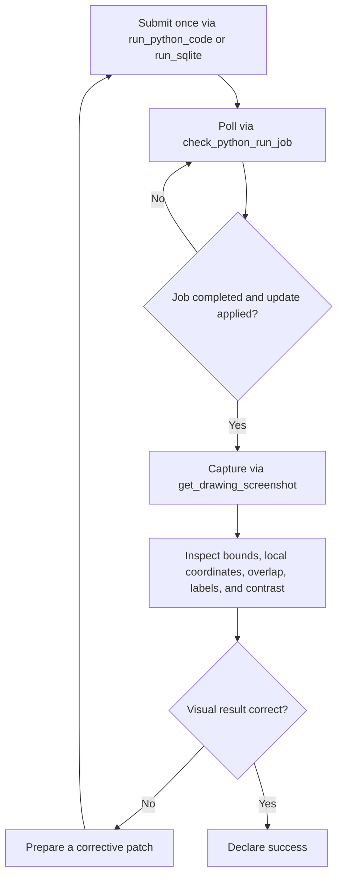

# Scopture Canvas Creation, Search, and Manipulation

Scopture is an interactive, multi-agent CAD pipeline that turns natural-language requests into validated operations synchronized with a live canvas. Scopture is the application; DUC (`.duc`) is its **gzip-compressed SQLite** project-state format.

This skill focuses strictly on **live canvas synchronization**, using the **Scopture MCP server tools**, writing scripts within the current sandbox environment, applying **premium canvas design standards**, and executing the **Visual QA verification loop**.

> For reference: Scopture is the app; Duc (.duc) is the data format and core library used by the app.

> [!IMPORTANT]
> **Code Writing API Reference**
> To handle the .duc file or related syntax, refer to the **duc skill** (and its bundled `./docs/` folder).

---

## Drawing-Level Python Runtime Environment

Scopture provides a full Python runtime environment that operates against the **drawing as a whole**. It is **not bound or scoped to any individual element**.

* **Whole-Drawing Operations**: The runtime is not limited to an isolated element or an embedded script container. Code executes with holistic visibility over the entire drawing, able to inspect elements, compute canvas-wide layouts, coordinate alignments, manage layers and groups, and orchestrate complex multi-element assemblies (e.g., schematics, floor plans, structural grids, or multi-view mechanical drawings).
* **Engineering & Scientific Stack**: Use the maintained [Python Sandbox reference](https://site.scopture.com/docs/automation/python-sandbox) for the shared Python 3.12 capability map, output types and embedded helpers. Desktop prefers its managed sandbox even for remote drawings; browser/mobile require an authorized cloud worker. Installed packages do not bypass network/process guards or establish physical validation. Keep reusable geometry in one Model Element and import it into individual studies.
* **Unified Batch Generation**: A single Python execution can generate, reposition, or update dozens of elements, create layers, instantiate blocks, and update global states in one unified patch.
* **Execution Surfaces**: This drawing-level runtime environment can be invoked via the Scopture MCP server (`run_python_code`) against an active live canvas, or headlessly via the CLI (`scopture run-python`) against local or remote `.duc` drawings.

---

## Choosing a Geometry Engine

Choose by what the output is for, not only by the object's category. Use the live `run_python_code` tool description for the exact output contract and helper calls.

* **IFC (`ifcopenshell`)**: The result is a building or infrastructure element that needs BIM semantics: walls, slabs, structural frames, doors, windows, building MEP (ducts, pipes, conduit, panels).
* **`build123d` (default)**: Manufactured or discrete 3D geometry: parts, brackets, assemblies, enclosures, robotics, tooling, electrical hardware such as housings and mounts.
* **Mixed cases**: Equipment or fittings inside a building follow the deliverable. Use IFC if it must appear in the building model, `build123d` if it is a part to be made. If unclear, ask the user.
* **`ezdxf`**: Only when DXF itself is needed, such as interchange, CNC or laser paths, or layer-based drafting conventions. For ordinary 2D content on the canvas, use native DUC elements.

> The Python sandbox can produce more than 3D models. Choose the output form by whether the result should stay editable on the canvas.

* **Native DUC elements**: Use for anything the user may select, restyle, or dimension: schematics, wiring diagrams, P&IDs, tables, annotations, and text. Compute with the engineering stack, then emit elements.
* **Raster images (PNG/JPEG)**: Use for computed, read-only visuals such as matplotlib plots, simulation contours, heatmaps, and renders. PNG for plots and diagrams, JPEG for photographic content.
* **SVG**: Use when vector fidelity matters but element-by-element editing does not, such as charts or vector artwork. If it needs to stay editable, rebuild it as native elements. Check the `ducsvg` adapter reference for conversion options.
* **Mermaid diagrams**: For a Python Model Element, use the sandbox built-in `get_svg_from_mermaid(source, *, css="")`. Emit the SVG once from the rendering root with `emit_output(get_svg_from_mermaid(source), kind="svg")`. Multiline source can include common indentation and surrounding blank lines, using `"""` syntax is favorable. The optional `css` accepts inline `--pele-*` declarations such as `--pele-surface: #e5eeff;` and defaults to the Scopture theme.
* **PDF / Typst**: Use for documents such as data sheets, calculation reports, and specification summaries. Typst sources are validated by the sandbox on submit.
* **Delivery**: Embed files through the patch's `external_files` map and reference them from an element. Follow the live `run_python_code` description for the exact fields.

Stay within the installed stack (`numpy`, `scipy`, `sympy`, `pint`, `pandas`, `matplotlib`, `fluids`). Do not promise FEA, raytraced rendering, or other image libraries unless a job confirms they are installed. Verify results with the Visual QA loop.

---

## MCP Tools vs. Python Sandbox Globals

The MCP tool registry and the Python sandbox expose different interfaces:

* **MCP `get_drawing` tool**: Returns drawing metadata, a state hash, and optional live `appState`. It does **not** return `.duc` bytes.
* **MCP `get_elements` tool**: Returns compact element data and can filter by type, IDs, or bounding box. Prefer it when full drawing parsing is unnecessary.
* **MCP `run_python_code` tool**: Submits a Python job. It is asynchronous by default; submit once and poll the returned `jobId` with `check_python_run_job`.
* **MCP `run_sqlite` tool**: Runs read or mutate SQL modes through the same asynchronous job flow.
* **Python sandbox**: Runs submitted code in an isolated Python 3.12 environment with the active drawing, requested external files, model-output capture, and injected helper functions. Use the live `run_python_code` tool description for the MCP job contract.

---

## Current `run_python_code` Sandbox

Scopture currently exposes one remote execution contract for MCP Python jobs.

The sandbox mounts authorized inputs into a temporary workspace, captures standard output and model previews, and returns a job result. It does not infer a drawing mutation from variables or printed output. The script must explicitly submit a drawing update through the injected helper documented by `run_python_code`.

`ducpy` is installed but **not** pre-imported. There is no `_existing_state` global and no mandatory `_elements` output list. Import the libraries the job needs and submit at most one intended mutation per job.

> [!IMPORTANT]
> **Direct Patch Rule**
> The injected drawing-update helper accepts dictionary/object input and performs serialization plus embedded Python/Typst validation inside the sandbox. Do not call `serialize_duc()` merely to submit builder-created elements.

### Engineering Python Stack

For complex calculations, physical simulations, and engineering problem solving, the sandbox includes `numpy`, `scipy`, `sympy`, `pint`, `pandas`, `matplotlib`, and `fluids`. Use them for numerical methods, symbolic derivation, unit-aware calculations, data analysis, simulation contours, plotting, and fluid-system calculations, then translate the results directly into DUC elements, `build123d`/`ifcopenshell`/`ezdxf` geometry, or multi-modal visual artifacts.

---

## Drawing Patch Semantics

Scopture merges sandbox patch collections by item ID. This is an additive/upsert patch, **not** complete-state replacement:

Do not round-trip the whole drawing through `get_drawing()`, edit it, and submit everything again. Build the smallest patch containing only records that were added or changed. Use `get_drawing()` only when the code genuinely needs raw current-state bytes for inspection or calculation.

* **ADD**: Submit an item with a new ID.
* **UPDATE**: Submit a complete valid updated item with the same ID. Matching collection items are replaced as records, not merged field by field.
* **DELETE**: Submit the existing element with `is_deleted: true`, preserving its ID and required relationships.
* **OMISSION**: An omitted item remains unchanged; omission does not delete it.

Dictionary and file maps merge by key. The current local state is preserved, while global state changes only when the patch supplies it.

For dictionary/object input, use the sandbox serializer's snake_case keys, including `elements`, `blocks`, `block_instances`, `block_collections`, `groups`, `regions`, `layers`, `external_files`, and `duc_global_state`.

Preserve IDs, bindings, memberships, frame/layer relationships, and block-instance data when updating an existing element. Locked plots and their descendants are protected at the server update boundary and cannot be bypassed from Python or SQLite.

## Drawing Target Resolution and Search

1. **Resolve named targets first.** When the user says "in", "inside", or "from" a named drawing, call `list_available_drawings` before querying. Prefer an exact name match and use the resolved `drawingId`; do not assume the active drawing is the target or search all drawings indiscriminately. Ask which drawing if matches remain ambiguous. If no match exists, say the target was not found among available workspace drawings.
2. **Choose the SQL mode and poll once-submitted jobs.** `run_sqlite` accepts up to 100 `drawingIds` in per-drawing mode, 10 distinct drawings in attached mode, and one drawing in mutate mode. Server jobs queue behind bounded workers; submit once and poll the returned `jobId` with `check_python_run_job`. A pending response is not a reason to resubmit.
3. **Conclude every search clearly.** Summarize the matches conversationally. For zero results, say: `Nothing found: No elements matching '<query>' were found in '<drawingName>'.`

## Issue and Charter Deletion

You cannot delete Issues or Charter requirements, constraints, or decisions through Scopture automation. If asked to delete them, tell the user they must do it manually in Scopture. Do not bypass this through CLI, SQL, or Python. Close or dismiss an Issue only when that is the requested action.

---

## Drawing Deep Links

Open a drawing at `/w/<drawingId>` and use these search parameters on the initial page load:

* **`?element=<elementId>`**: Selects the element and scrolls or zooms the canvas to it. The implemented key is `element`, not `elementId`.
* **`?modelOpen=<elementId>`**: Opens a valid Model Element directly in Model Open mode so the user can interact with its 3D or other model representation. Access settings can disable 3D mode for public links.
* **`?issue=<issueId>`**: Opens the drawing's issues panel for the referenced issue.

Combine parameters with `&` when needed, for example `/w/<drawingId>?element=<elementId>&modelOpen=<elementId>`.

---

## Visual QA and Verification Loop

Approach drawings with a critical eye. Do not declare success before the asynchronous update has been applied and the visible result has been inspected when a live client is available.

---

## MCP Reference Guide

Use the `scopture mcp` server to obtain active drawing context, inspect compact elements, search drawing text, execute Python or SQLite jobs, poll job completion, inspect versions, and capture live screenshots. Retrieve the live tool descriptions and schemas before choosing arguments; do not reproduce those volatile schemas in this skill.

---

## Common Failures & Self-Correction

- **Parsing active drawing bytes fails**: Current `ducpy.parse_duc()` is path-based. Retrieve the installed-version parsing documentation and use a temporary path or a byte-oriented `DucSQL` workflow.
- **Submitting serialized builder output fails**: Current `serialize_duc()` returns an output path, not bytes. Prefer dictionary/object input through the sandbox's drawing-update helper.
- **Canvas appears unchanged**: Confirm the script explicitly submitted a drawing update, then poll the original job with `check_python_run_job` until the update is finalized.
- **Duplicate mutations**: Never rerun a pending non-idempotent Python or SQLite job. Poll its original `jobId`.
- **Attribute errors or invalid schemas**: Retrieve the current `llms.txt` route and verify the installed builder stage, method, parameter, and return type.
- **Element Overlaps & Clipping**: Execute the Visual QA verification loop (`get_drawing_screenshot`) and adjust bounding box offsets or coordinates accordingly.
- **Invisible 2D CAD Elements**: Elements missing on the canvas might lack a default fill or stroke. Always assign explicit styles (backgrounds and strokes) when generating 2D CAD. See [Styling Elements](https://duc.ducflair.com/docs/guidelines/styling-elements).
